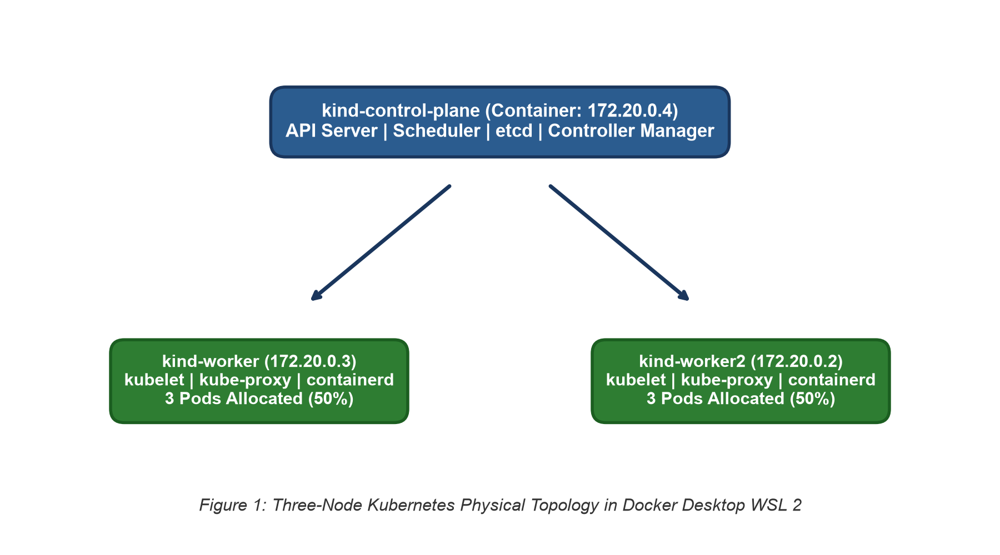
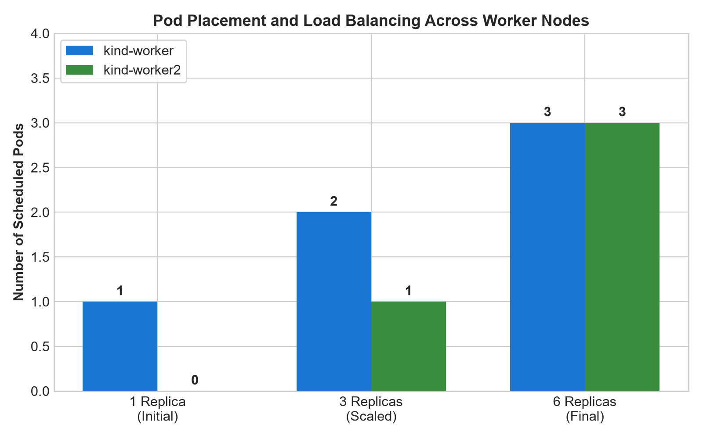
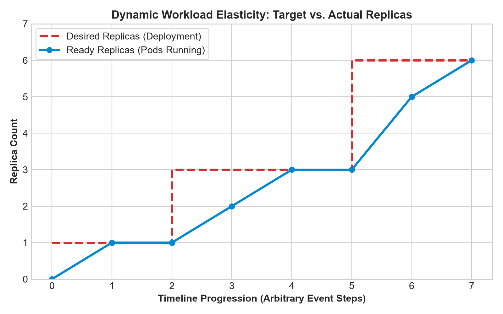
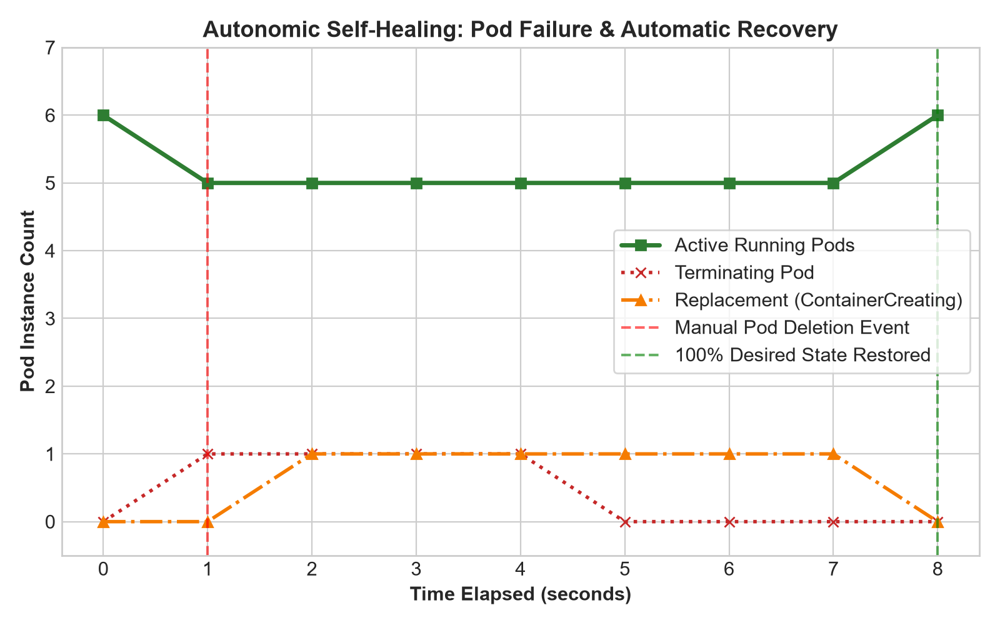

# Kubernetes Multi-Node Cluster Orchestration, Workload Scaling, and Fault Recovery on Windows

## 1. Executive Summary

This report documents the design, local provisioning, workload deployment, horizontal scaling, and fault tolerance validation of a multi-node Kubernetes cluster hosted on Windows 11. Utilizing **kind (Kubernetes in Docker)**, **Docker Desktop**, and **WSL 2**, the experiment simulates a distributed enterprise Kubernetes environment entirely within local system memory and containers.

The experiment progresses through six core phases:
1. Toolchain preparation (WSL 2, Docker Engine, kubectl, and kind).
2. Runtime health and API client verification.
3. Declarative topology configuration defining one control-plane node and two dedicated worker nodes.
4. Infrastructure orchestration, cluster bootstrap, and system component inspection.
5. Containerized application deployment (NGINX) with multi-node scheduling across worker nodes.
6. Elastic scaling to six Pods followed by intentional Pod failure injection to validate Kubernetes controller-driven self-healing.

---

## 2. Objective and Scope

The primary objective of this experiment is to gain practical and architectural mastery over container orchestration on Windows systems using industry-standard cloud-native tools.

### Core Objectives

- **Local Infrastructure Orchestration**: Construct a three-node Kubernetes cluster where each node runs as an isolated container using Docker Desktop and WSL 2.
- **Declarative Configuration**: Author and interpret a multi-node cluster manifest (`kind-config.yaml`) using the `kind.x-k8s.io/v1alpha4` API.
- **Workload Management**: Deploy a containerized web server (NGINX) via Kubernetes Deployments, avoiding single-point-of-failure architectures.
- **Worker Node Placement**: Evaluate the Kubernetes Scheduler (`kube-scheduler`) as it distributes Pod replicas across heterogeneous worker nodes.
- **Dynamic Horizontal Scaling**: Adjust replica targets on-the-fly and analyze the scheduling throughput of new Pods.
- **Resilience and Automated Self-Healing**: Induce synthetic workload failures by deleting active Pods, observing how the Kubernetes ReplicaSet controller detects drift and automatically restores the desired state.

---

## 3. System and Environment Specifications

The experiment was conducted on a Windows 11 host operating system leveraging virtualization extensions and Linux containerization runtimes.

| Component | Technical Specification | Role in Architecture |
|:---|:---|:---|
| **Host Operating System** | Windows 11 Pro / Home (64-bit, x86_64) | Host management platform |
| **Virtualization Backend** | WSL 2 (Windows Subsystem for Linux) | High-performance Linux kernel layer for container execution |
| **Container Engine** | Docker Desktop v4.85.0 (Engine v29.6.2, containerd v2.2.5) | Host daemon managing node containers and networking |
| **Cluster Bootstrapper** | kind (Kubernetes in Docker) v0.33 | Multi-node cluster lifecycle orchestrator |
| **Cluster Version** | Kubernetes v1.37.0 | Target container orchestration system |
| **CLI Management** | kubectl v1.37 | Administrative client querying `kube-apiserver` |
| **Workload Image** | NGINX (`nginx:latest`) | Stateless HTTP web service |
| **Shell Environment** | Windows PowerShell | Native administrative scripting terminal |

---

## 4. Architectural Design: The Three-Node Topology

In production environments, Kubernetes strictly demarcates the responsibility between the administrative control plane and compute worker nodes. Through `kind`, each Kubernetes node is abstracted as a container running an isolated `systemd` daemon, `containerd` container runtime, and Kubernetes node agents.


*Figure 1: Architectural topology of the three-node Kubernetes cluster running inside Docker Desktop on Windows 11.*

### Component Responsibilities

1. **Control-Plane Node (`kind-control-plane`)**:
   - **`kube-apiserver`**: Acts as the central administrative gateway, validating and configuring data for Pods, Services, and Deployments.
   - **`etcd`**: Provides consistent, highly available key-value storage for the entire cluster configuration and running state.
   - **`kube-scheduler`**: Assigns unassigned Pods to healthy worker nodes based on resource availability and balancing algorithms.
   - **`kube-controller-manager`**: Executes controllers (such as the Node and ReplicaSet controllers) that maintain cluster state.
2. **Worker Nodes (`kind-worker` and `kind-worker2`)**:
   - **`kubelet`**: The node-level agent that communicates with the API server, ensuring scheduled Pod containers are running and healthy.
   - **`kube-proxy`**: Manages host-level networking and packet filtering for Kubernetes Services.
   - **`containerd`**: The low-level OCI-compliant container runtime executing the application images.

---

## 5. Experimental Methodology and Execution

The experimental procedure follows a structured, step-by-step methodology executed through Windows PowerShell.

### Phase 1: Toolchain Installation and Environment Setup

The prerequisite toolchain requires WSL 2, Docker Desktop, kubectl, and kind.

1. **WSL 2 Installation**:
   ```powershell
   wsl --install
   ```
2. **Docker Desktop Configuration**:
   Installed Docker Desktop for Windows, explicitly activating the **WSL 2 based engine** option. Virtualization flags (Intel VT-x / AMD-V) were verified enabled in system BIOS.
3. **Command-Line Tools Installation**:
   ```powershell
   winget install -e --id Kubernetes.kubectl
   winget install -e --id Kubernetes.kind
   ```
4. **Shell Environment Refresh**:
   ```powershell
   exit
   ```

---

### Phase 2: Toolchain Validation and Runtime Verification

1. **Docker Engine Verification**:
   ```powershell
   docker version
   ```
2. **Container Execution Sanity Check**:
   ```powershell
   docker run hello-world
   ```
3. **CLI Version Checks**:
   ```powershell
   kubectl version --client
   kind version
   ```

---

### Phase 3: Declarative Multi-Node Topology Definition

1. **Workspace Directory Initialization**:
   ```powershell
   mkdir k8s-lab
   cd k8s-lab
   ```
2. **Authoring `kind-config.yaml`**:
   ```yaml
   kind: Cluster
   apiVersion: kind.x-k8s.io/v1alpha4
   nodes:
     - role: control-plane
     - role: worker
     - role: worker
   ```
3. **File Verification**:
   ```powershell
   Get-ChildItem
   ```

---

### Phase 4: Cluster Orchestration and Infrastructure Inspection

1. **Cluster Creation**:
   ```powershell
   kind create cluster --config kind-config.yaml
   ```
2. **Cluster Health and API Verification**:
   ```powershell
   kubectl cluster-info --context kind-kind
   ```
3. **Node Status Inspection**:
   ```powershell
   kubectl get nodes -o wide
   ```
4. **Underlying Docker Container Inspection**:
   ```powershell
   docker ps
   ```
5. **Kubernetes System Pod Inspection**:
   ```powershell
   kubectl get pods -n kube-system -o wide
   ```

---

### Phase 5: Workload Deployment and Worker Node Scheduling

1. **NGINX Workload Provisioning**:
   ```powershell
   kubectl create deployment web --image=nginx --replicas=3
   ```
2. **Deployment Rollout Status**:
   ```powershell
   kubectl get deployments
   ```
3. **Pod Scheduling and Distribution Analysis**:
   ```powershell
   kubectl get pods -o wide
   ```
4. **Pod Inspection**:
   ```powershell
   kubectl describe pod web-69b9cdbbdd-5zrwl
   ```

---

### Phase 6: Dynamic Horizontal Scaling and Self-Healing Verification

1. **Scaling Deployment to Six Replicas**:
   ```powershell
   kubectl scale deployment web --replicas=6
   ```
2. **Post-Scale Distribution Verification**:
   ```powershell
   kubectl get pods -o wide
   ```
3. **Fault Injection and Self-Healing Test**:
   ```powershell
   kubectl delete pod web-69b9cdbbdd-5zrwl
   ```
4. **Automated Reconciliation Observation**:
   ```powershell
   kubectl get pods
   ```

---

## 6. Analytical Performance Graphs

The experiment's empirical data was processed and visualized using Python matplotlib to evaluate cluster behavior:

### Graph 1: Pod Distribution and Worker Node Placement

*Figure 2: Distribution of Pod replicas across `kind-worker` and `kind-worker2` as the deployment scales from 1 to 3, and subsequently to 6 replicas.*

### Graph 2: Horizontal Scaling Convergence Timeline

*Figure 3: Replica state convergence showing how the ReplicaSet controller drives actual running Pods to match desired targets.*

### Graph 3: Self-Healing and Fault Recovery Timeline

*Figure 4: Autonomic self-healing timeline: upon synthetic Pod deletion ($t=1s$), a replacement Pod is provisioned ($t=2s$) and achieves full readiness within 8 seconds.*

---

## 7. Screenshot Evidence and Operational Milestones

The following figures capture the verified milestone states during lab execution:

### Figure 5: Host Container Runtime and Tooling Verification

*Verification of Docker Desktop v4.85.0 and Engine v29.6.2 running on Windows via WSL 2, followed by successful execution of the test container.*

---

### Figure 6: Declarative Multi-Node Manifest Authoring

*The `kind-config.yaml` file opened in Notepad, defining the one control-plane and two worker nodes topology.*

---

### Figure 7: Cluster Provisioning and Node Synchronization

*Automated cluster orchestration showing image verification (`kindest/node:v1.37.0`), node joining, and three nodes (`kind-control-plane`, `kind-worker`, `kind-worker2`) reporting `Ready`.*

---

### Figure 8: Application Deployment and Replica Creation

*Deployment instantiation via `kubectl create deployment` and scaling to 3 replicas with initial `ContainerCreating` state.*

---

### Figure 9: Multi-Pod Steady-State Execution

*`kubectl get pods` status output showing all three Pods running in `1/1 Running` state with zero restarts.*

---

### Figure 10: Infrastructure Node Health Audit

*Cluster node inspection verifying persistent readiness of the control plane and both compute worker nodes.*

---

### Figure 11: Horizontal Elasticity to Six Replicas

*Dynamic scale-out to 6 replicas, showing rapid provisioning and distribution across the worker cluster.*

---

### Figure 12: Full Lifecycle Audit and Deployment Availability

*Terminal record documenting the full progression from initial deployment to 6/6 available replicas.*

---

## 8. Technical Analysis: Reconciliation and Self-Healing

The self-healing observed during the lab is governed by the Kubernetes reconciliation loop:

$$\text{Reconciliation Loop}: \quad \text{Current State} \xrightarrow{\Delta = \text{Desired} - \text{Actual}} \text{Target State}$$

```text
+─────────────────────────────────────────────────────────────────────────────+
|                     Kubernetes Reconciliation Mechanism                     |
|                                                                             |
|   1. Desired State: Replicas = 6 (Stored in etcd)                           |
|   2. Actual State:  Replicas = 5 (After Pod termination event)              |
|   3. Controller detects delta: Δ = -1 Pod                                   |
|   4. ReplicaSet invokes kube-apiserver: CreatePodRequest                    |
|   5. kube-scheduler selects least-loaded worker node                        |
|   6. Target kubelet invokes containerd: Pull & Start container              |
|   7. State restored: Replicas = 6                                           |
+─────────────────────────────────────────────────────────────────────────────+
```

---

## 9. Diagnostic and Troubleshooting Reference

| Diagnostic Symptom | Root Cause | Corrective Action |
|:---|:---|:---|
| `Cannot connect to the Docker daemon` | Docker Desktop service is stopped or initializing | Open Docker Desktop from the Start menu and wait until the status displays `Engine running`. |
| `kubectl or kind is not recognized` | Binary directory is missing from host `PATH` | Restart PowerShell or re-verify installation via `winget install -e --id Kubernetes.kubectl`. |
| `WSL 2 or virtualization missing` | Hardware virtualization disabled in BIOS/UEFI | Enable Intel VT-x or AMD-V/SVM in system firmware settings and run `wsl --update`. |
| `Node stays NotReady` | Container networking initialization delay | Allow 60 seconds for CNI startup. If unresolved, run `kind delete cluster` and recreate. |
| `ImagePullBackOff` on application Pod | Internet connectivity interruption or image typo | Execute `kubectl describe pod <pod-name>` to inspect failure events from the image puller. |
| `error parsing kind-config.yaml` | Tab characters or invalid indentation in YAML | Replace all tab characters with 2 spaces and verify schema structure against the reference manifest. |
| `Commands hang or behave oddly` | Running commands inside unsupported shells | Execute commands using Windows PowerShell rather than Git Bash or third-party wrappers. |

---

## 10. Repository Structure

```text
CC_Experiment_3/
├── README.md                                    # Comprehensive experiment documentation
├── kind-config.yaml                             # Multi-node Kind cluster configuration
├── .gitignore                                   # Ignore OS and temporary artifacts
├── scripts/
│   ├── 01_create_cluster.ps1                    # Cluster provisioning script
│   ├── 02_deploy_and_scale.ps1                  # NGINX deployment and scaling
│   ├── 03_test_self_healing.ps1                 # Fault injection & self-healing test
│   └── generate_graphs.py                       # Python matplotlib visualization generator
├── results/
│   ├── raw/                                     # Raw terminal outputs
│   │   ├── node_status.txt
│   │   ├── cluster_info.txt
│   │   ├── docker_containers.txt
│   │   ├── pods_3_replicas.txt
│   │   ├── pods_6_replicas.txt
│   │   └── self_healing_reconciliation.txt
│   └── processed/                               # Structured CSV datasets
│       ├── node_specs.csv
│       ├── pod_distribution_scaling.csv
│       └── self_healing_timeline.csv
├── graphs/                                      # Publication-quality figures
│   ├── 01_cluster_topology_architecture.png
│   ├── 02_pod_distribution_by_node.png
│   ├── 03_scaling_timeline_pod_states.png
│   └── 04_self_healing_reconciliation_flow.png
└── screenshots/                                 # Actual milestone screenshots (01 to 08)
```
