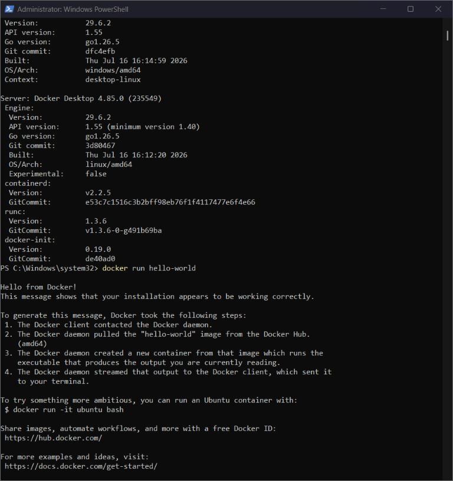
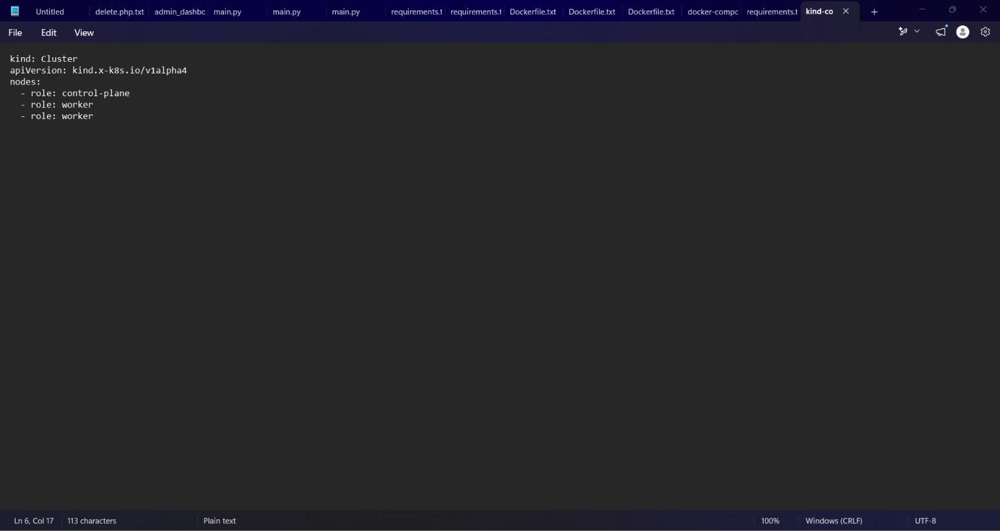
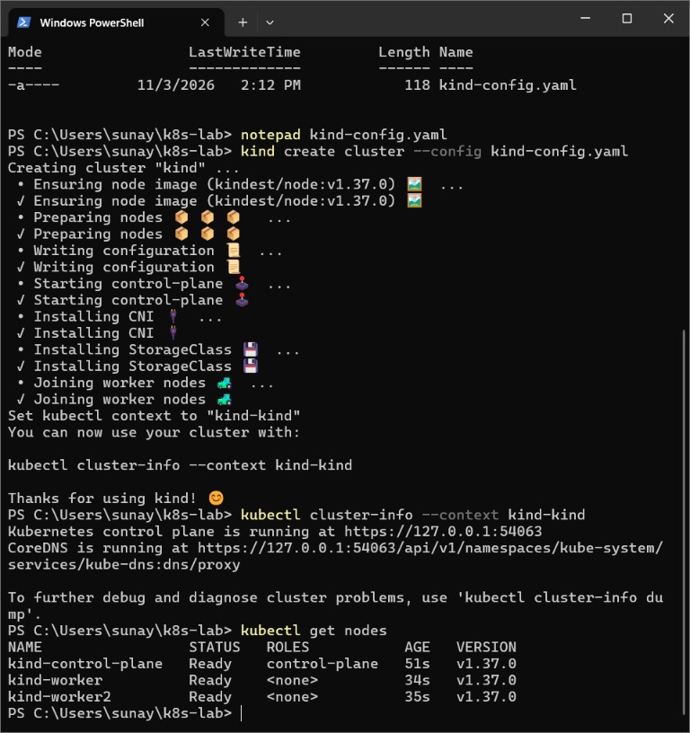
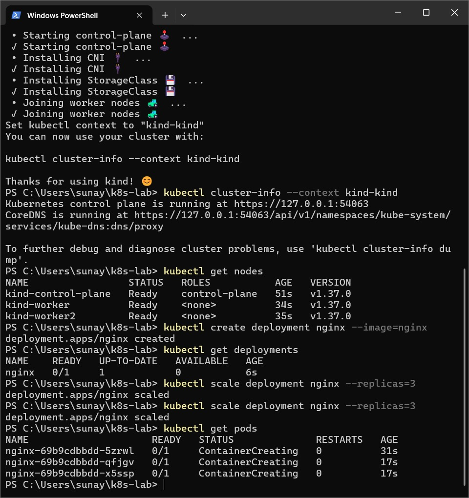
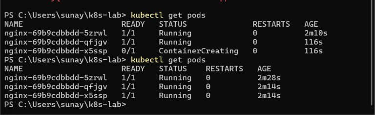
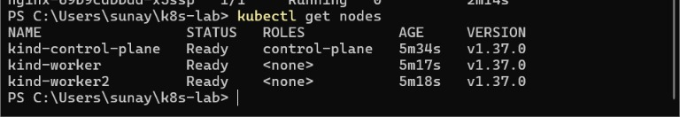
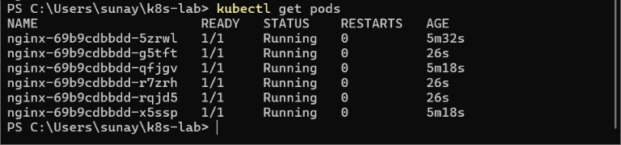
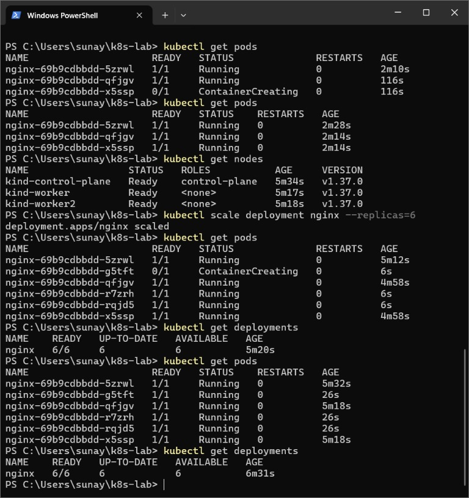

# Kubernetes Lab on Windows: Three-Node Cluster, NGINX Deployment, Scaling, and Self-Healing

## 1. Project Overview

This repository documents the setup, deployment, lifecycle management, and architectural verification of a local multi-node Kubernetes cluster running on Windows 11 using **kind** (Kubernetes in Docker), **Docker Desktop**, and **WSL 2**. 

The lab provisions a production-style three-node Kubernetes topology consisting of one control-plane node and two dedicated worker nodes. Within this cluster, an NGINX web server deployment is initialized, scaled across worker nodes, inspected, and tested for elasticity and controller-driven self-healing.

---

## 2. Objectives

- Provision a local multi-node Kubernetes cluster (1 control-plane and 2 worker nodes) on Windows using `kind` and Docker containers.
- Understand the role of declarative cluster manifests (`kind-config.yaml`).
- Validate container runtime health and Kubernetes API connectivity through native Windows PowerShell commands.
- Deploy an containerized NGINX application workload managed by a Kubernetes Deployment controller.
- Dynamically scale the workload from 1 to 3 replicas, and subsequently to 6 replicas, observing scheduling distribution across worker nodes.
- Analyze the internal Kubernetes control loop (reconciliation) responsible for automated self-healing upon Pod termination.

---

## 3. Tools and Technologies Used

| Tool / Technology | Role in Lab | Version / Specifications |
|:---|:---|:---|
| **Operating System** | Host development environment | Windows 11 (x86_64) |
| **WSL 2** | Windows Subsystem for Linux backend | Linux kernel integration for Docker |
| **Docker Desktop** | Host containerization engine running kind node containers | v4.85.0 (Engine v29.6.2, containerd v2.2.5, runc v1.3.6) |
| **kind** | Tool for running local Kubernetes clusters using Docker containers | Latest Windows binary (Node Image: `kindest/node:v1.37.0`) |
| **kubectl** | Kubernetes command-line client communicating with kube-apiserver | Windows CLI |
| **Kubernetes (k8s)** | Container orchestration platform | v1.37.0 |
| **NGINX** | Containerized web server application workload | `nginx:latest` |
| **Windows PowerShell** | Command shell and script execution environment | Windows PowerShell 5.1 / PowerShell 7 |

---

## 4. Prerequisites

Before executing this lab, the following components must be configured on Windows:

1. **Hardware Virtualization**: Enabled in the system BIOS/UEFI (Intel VT-x or AMD-V).
2. **WSL 2 (Windows Subsystem for Linux)**: Installed and updated with default distribution (e.g., Ubuntu).
3. **Docker Desktop for Windows**:
   - Configured with WSL 2 backend (`Settings -> General -> Use the WSL 2 based engine`).
   - Linux containers mode selected (`desktop-linux` context).
4. **kind Binary**: Downloaded and added to the Windows System `PATH`.
5. **kubectl CLI**: Installed and accessible from PowerShell.

---

## 5. Architecture: The Three-Node Cluster

In production environments, Kubernetes strictly separates the control plane from worker workloads to ensure fault tolerance, security, and workload isolation. Through `kind`, each Kubernetes node is instantiated as an independent, lightweight Docker container running inside the Docker daemon.

```text
+-----------------------------------------------------------------------------------+
|                              Windows 11 Host OS                                   |
|  +-----------------------------------------------------------------------------+  |
|  |                    Docker Desktop (WSL 2 Backend)                           |
|  |                                                                             |
|  |  +-----------------------+  +---------------------+  +---------------------+  |  |
|  |  |   kind-control-plane  |  |     kind-worker     |  |    kind-worker2     |  |  |
|  |  |      (Container)      |  |     (Container)     |  |     (Container)     |  |  |
|  |  |                       |  |                     |  |                     |  |  |
|  |  |  * kube-apiserver     |  |  * kubelet          |  |  * kubelet          |  |  |
|  |  |  * etcd               |  |  * kube-proxy       |  |  * kube-proxy       |  |  |
|  |  |  * kube-scheduler     |  |  * containerd       |  |  * containerd       |  |  |
|  |  |  * kube-controller-   |  |                     |  |                     |  |  |
|  |  |    manager            |  |  [ NGINX Pods ]     |  |  [ NGINX Pods ]     |  |  |
|  |  +-----------^-----------+  +----------^----------+  +----------^----------+  |  |
|  +--------------|-------------------------|------------------------|-----------+  |
|                 |                         |                        |              |
|          kubectl CLI (PowerShell) --------+------------------------+              |
+-----------------------------------------------------------------------------------+
```

### Node Roles and Responsibilities

1. **Control-Plane Node (`kind-control-plane`)**:
   - **kube-apiserver**: Front-end entry point serving REST queries, validating specifications, and updating cluster state.
   - **etcd**: Consistent, highly available key-value store holding the complete cluster configuration and state.
   - **kube-scheduler**: Watches newly created Pods without assigned nodes and assigns them to optimal worker nodes based on resource constraints and affinity.
   - **kube-controller-manager**: Runs controllers that regulate the state of the cluster (Deployment controller, ReplicaSet controller, Node controller).
2. **Worker Nodes (`kind-worker`, `kind-worker2`)**:
   - **kubelet**: Agent running on each node ensuring that containers described in PodSpecs are running and healthy.
   - **kube-proxy**: Maintains network rules on nodes allowing network communication to Pods from inside or outside the cluster.
   - **containerd**: Container runtime executing the actual application containers.

---

## 6. Cluster Specification (`kind-config.yaml`)

The multi-node cluster topology is defined declaratively using Kind's `v1alpha4` configuration API:

```yaml
kind: Cluster
apiVersion: kind.x-k8s.io/v1alpha4
nodes:
  - role: control-plane
  - role: worker
  - role: worker
```

### Breakdown of Declarative Properties

- `kind: Cluster`: Defines the object as a kind cluster specification.
- `apiVersion: kind.x-k8s.io/v1alpha4`: Schema version supported by kind v0.20+.
- `nodes`: List of virtual nodes to generate as Docker containers:
  - Entry 1 (`role: control-plane`): Instructs kind to configure the Kubernetes control plane components and expose the API server.
  - Entry 2 (`role: worker`): Designates a worker node that registers with the control plane to host scheduled workloads.
  - Entry 3 (`role: worker`): Designates a second worker node enabling multi-node workload distribution and high availability testing.

---

## 7. Step-by-Step Execution Guide

All commands are executed from Windows PowerShell in the lab working directory.

### Step 1: Verify Host Prerequisites and Docker Engine

Confirm that the Docker engine is running and able to execute containers:

```powershell
docker version
docker run hello-world
```

*Expected Outcome:* Docker prints client and server version details (showing Engine 29.6.2 on Windows/WSL2) and confirms container execution with "Hello from Docker!".

### Step 2: Define Cluster Configuration

Create the cluster manifest file `kind-config.yaml` using Notepad or any code editor:

```powershell
notepad kind-config.yaml
```

Insert the YAML configuration specifying one control plane and two worker nodes, then save.

### Step 3: Create the Multi-Node Cluster

Deploy the multi-node Kubernetes cluster using kind:

```powershell
kind create cluster --config kind-config.yaml
```

*Process Executed by kind:*
1. Ensures the base node container image (`kindest/node:v1.37.0`) is present.
2. Prepares three Docker containers.
3. Writes Kubernetes system configurations.
4. Initializes control plane services (etcd, apiserver, scheduler, controller-manager).
5. Installs the Container Network Interface (CNI) and local StorageClass.
6. Joins the two worker node containers (`kind-worker` and `kind-worker2`) to the cluster.
7. Generates a kubeconfig file and switches context to `kind-kind`.

### Step 4: Verify Cluster Connectivity and Nodes

Verify that `kubectl` can communicate with the API server and that all three nodes are online and reporting `Ready`:

```powershell
kubectl cluster-info --context kind-kind
kubectl get nodes
```

*Expected Output:*
```text
NAME                 STATUS   ROLES           AGE   VERSION
kind-control-plane   Ready    control-plane   51s   v1.37.0
kind-worker          Ready    <none>          34s   v1.37.0
kind-worker2         Ready    <none>          35s   v1.37.0
```

### Step 5: Inspect Underlying Docker Node Containers

Inspect the running Docker containers backing the virtual nodes:

```powershell
docker ps --filter "name=kind-"
```

*Expected Output:* Three active Docker containers (`kind-control-plane`, `kind-worker`, `kind-worker2`) running the `kindest/node:v1.37.0` image.

### Step 6: Inspect Kubernetes System Pods

Check that essential internal cluster services are running inside the `kube-system` namespace:

```powershell
kubectl get pods -n kube-system
```

*Expected Output:* Active Pods for `coredns`, `etcd-kind-control-plane`, `kube-apiserver-kind-control-plane`, `kube-controller-manager-kind-control-plane`, `kube-proxy`, and `kindnet` (CNI).

### Step 7: Deploy the NGINX Application

Create a Kubernetes Deployment managing an NGINX container:

```powershell
kubectl create deployment nginx --image=nginx
kubectl get deployments
```

Initially, the deployment creates a single replica. Check the deployment status:
```text
NAME    READY   UP-TO-DATE   AVAILABLE   AGE
nginx   0/1     1            0           6s
```

### Step 8: Scale to Three Replicas and Verify Pod Distribution

Scale the deployment up to 3 replicas so that multiple Pods can be balanced across the available worker nodes:

```powershell
kubectl scale deployment nginx --replicas=3
kubectl get pods
```

Monitor until all three Pods transition from `ContainerCreating` to `Running`:

```text
NAME                     READY   STATUS    RESTARTS   AGE
nginx-69b9cdbbdd-5zrwl   1/1     Running   0          2m28s
nginx-69b9cdbbdd-qfjgv   1/1     Running   0          2m14s
nginx-69b9cdbbdd-x5ssp   1/1     Running   0          2m14s
```

To see which specific worker node hosts each Pod, execute:

```powershell
kubectl get pods -o wide
```

The Kubernetes scheduler distributes the Pods across `kind-worker` and `kind-worker2`.

### Step 9: Inspect a Pod with Detailed Diagnostics

Inspect the internal metadata, IP addresses, events, and lifecycle hooks of a running Pod:

```powershell
kubectl describe pod nginx-69b9cdbbdd-5zrwl
```

### Step 10: Scale the Deployment to Six Replicas

Scale the workload to 6 replicas to observe cluster elasticity:

```powershell
kubectl scale deployment nginx --replicas=6
kubectl get pods
kubectl get deployments
```

*Observed Result:* The ReplicaSet immediately schedules 3 additional Pods (`g5tft`, `r7zrh`, `rqjd5`). Within seconds, all 6 replicas reach `1/1 Running`, and the deployment status reports `6/6 AVAILABLE`:

```text
NAME                     READY   STATUS    RESTARTS   AGE
nginx-69b9cdbbdd-5zrwl   1/1     Running   0          5m32s
nginx-69b9cdbbdd-g5tft   1/1     Running   0          26s
nginx-69b9cdbbdd-qfjgv   1/1     Running   0          5m18s
nginx-69b9cdbbdd-r7zrh   1/1     Running   0          26s
nginx-69b9cdbbdd-rqjd5   1/1     Running   0          26s
nginx-69b9cdbbdd-x5ssp   1/1     Running   0          5m18s
```

### Step 11: Verify Self-Healing Behavior

Kubernetes Deployments are governed by declarative state. To test self-healing, terminate one running Pod:

```powershell
kubectl delete pod nginx-69b9cdbbdd-5zrwl
kubectl get pods
```

*Observed Behavior:* The deleted Pod transitions to `Terminating`. Concurrently, the ReplicaSet controller detects that the current replica count (5) is lower than the desired replica count (6), and instantly provisions a replacement Pod with a new random hash suffix.

---

## 8. Theoretical Analysis: Kubernetes Self-Healing & Scheduling

### The Reconciliation Control Loop

Kubernetes operates on a continuous declarative reconciliation model:

$$\text{Desired State} = \text{Current State}$$

```text
+-------------------------------------------------------------------+
|                     Kubernetes Control Loop                       |
|                                                                   |
|   +----------------+      Compare      +--------------------+     |
|   | Desired State  | <---------------> |   Current State    |     |
|   | (Replicas = 6) |                   |   (Replicas = 5)   |     |
|   +----------------+                   +--------------------+     |
|           |                                       ^               |
|           | Difference detected (Delta = -1)     |               |
|           v                                       |               |
|   +-----------------------------------------------+-----------+   |
|   | Controller Manager creates replacement Pod                |   |
|   | Scheduler binds Pod to least-utilized worker node         |   |
|   | Kubelet starts container via containerd                   |   |
|   +-----------------------------------------------------------+   |
+-------------------------------------------------------------------+
```

1. **Observe**: The ReplicaSet controller continuously watches the Kubernetes API server for Pod events in its namespace.
2. **Analyze**: When a Pod is manually deleted, crashes, or fails liveness probes, the actual count falls below the specified replica target.
3. **Act**: The controller immediately issues an API call to instantiate a new Pod matching the deployment template.
4. **Schedule**: The `kube-scheduler` assigns the unassigned Pod to the worker node with sufficient compute capacity.
5. **Execute**: The `kubelet` on that target worker node pulls the image and initiates the container.

---

## 9. Screenshot Evidence and Observations

The following screenshots document the actual lab execution milestones captured on the host machine.

### Figure 1: Docker Desktop and Engine Verification

*Verification of Docker Desktop 4.85.0 and Docker Engine 29.6.2 running on Windows with the WSL 2 backend, successfully executing the `hello-world` test container.*

---

### Figure 2: Multi-Node Kind Cluster Configuration Manifest

*The `kind-config.yaml` file opened in Windows Notepad declaring a 3-node topology: one control-plane and two worker nodes.*

---

### Figure 3: Kind Cluster Creation and Three Ready Nodes

*Automated cluster provisioning via `kind create cluster --config kind-config.yaml`. The output confirms node image validation (`v1.37.0`), CNI installation, and three nodes (`kind-control-plane`, `kind-worker`, `kind-worker2`) reporting `Ready` status.*

---

### Figure 4: NGINX Deployment Creation and Scaling to Three Replicas

*Creation of the NGINX deployment (`kubectl create deployment nginx --image=nginx`), followed by scaling to 3 replicas (`kubectl scale deployment nginx --replicas=3`) and the initial `ContainerCreating` status.*

---

### Figure 5: Three NGINX Pods Successfully Running

*Inspection of Pod status via `kubectl get pods` showing all three replicas (`5zrwl`, `qfjgv`, `x5ssp`) transitioned to `1/1 Running` with zero restarts.*

---

### Figure 6: Cluster Nodes Health and Role Verification

*Status check with `kubectl get nodes` confirming steady-state health for `kind-control-plane`, `kind-worker`, and `kind-worker2` running Kubernetes v1.37.0.*

---

### Figure 7: Scaling NGINX Deployment to Six Replicas

*Execution of `kubectl scale deployment nginx --replicas=6` and monitoring of the 6 running Pods (`5zrwl`, `g5tft`, `qfjgv`, `r7zrh`, `rqjd5`, `x5ssp`).*

---

### Figure 8: Full Terminal Lifecycle and Deployment Status

*Complete terminal record showing scaling command execution, transition from 3 to 6 replicas, and `kubectl get deployments` verifying `6/6` available replicas.*

---

## 10. PowerShell Automation Scripts

To ensure full reproducibility, custom PowerShell automation scripts are provided in the `scripts/` directory:

| Script Name | Purpose | Usage Command |
|:---|:---|:---|
| `scripts/create-cluster.ps1` | Verifies prerequisites (Docker, kind, kubectl) and provisions the 3-node cluster | `.\scripts\create-cluster.ps1` |
| `scripts/verify-cluster.ps1` | Validates cluster health, node readiness, kube-system Pods, and Docker containers | `.\scripts\verify-cluster.ps1` |
| `scripts/deploy-nginx.ps1` | Creates NGINX deployment and scales to 3 replicas | `.\scripts\deploy-nginx.ps1` |
| `scripts/scale-nginx.ps1` | Dynamically scales the deployment to a target replica count (default 6) | `.\scripts\scale-nginx.ps1 -Replicas 6` |

---

## 11. Learning Outcomes

1. **Declarative Infrastructure Management**: Mastered defining multi-node topologies in YAML rather than using manual, imperatively provisioned single-node environments.
2. **Kubernetes Control Plane Architecture**: Understood the separation of concerns between API handling, state management (etcd), scheduling, and node-level execution.
3. **Horizontal Pod Autoscaling & ReplicaSets**: Observed how Deployments manage underlying ReplicaSets to achieve elasticity without downtime.
4. **Resilience & Self-Healing**: Verified that the Kubernetes control loop automatically recovers from Pod failures to match the desired state.
5. **Windows-Native Cloud Development**: Gained practical experience configuring and troubleshooting Kubernetes and Docker within Windows 11 and WSL 2.

---

## 12. Troubleshooting Guide

| Issue Encountered | Root Cause | Resolution |
|:---|:---|:---|
| `failed to connect to the docker API` | Docker Desktop is stopped or starting up | Launch Docker Desktop, ensure WSL 2 integration is active, and wait until Docker Engine reports running. |
| `kind: command not found` | The kind executable is not in the system `PATH` | Place `kind.exe` in `C:\Windows\System32` or add its directory to user/system Environment Variables. |
| `kubectl: unable to connect to the server: connectex` | The cluster context is pointing to an offline or deleted cluster | Run `kubectl config get-contexts` and switch context using `kubectl config use-context kind-kind`. |
| Pods stuck in `ContainerCreating` | Container image download latency or Docker daemon memory saturation | Allow sufficient time for `nginx` image pull across worker nodes or adjust Docker Desktop resource limits. |
| Port conflicts when binding host ports | Another service is using ports 80/443 on Windows | Modify container port mappings in `kind-config.yaml` to use alternate ports (e.g., 8080/8443). |

---

## 13. Repository Structure

```text
CC_Experiment_3/
├── README.md                                    # Comprehensive experiment documentation
├── kind-config.yaml                             # Multi-node Kind cluster configuration
├── .gitignore                                   # Ignore OS and temporary artifacts
├── scripts/
│   ├── create-cluster.ps1                       # Cluster provisioning script
│   ├── verify-cluster.ps1                       # Cluster architecture & node health inspection
│   ├── deploy-nginx.ps1                         # NGINX deployment and scaling (3 replicas)
│   └── scale-nginx.ps1                          # Workload scaling (6 replicas)
└── screenshots/
    ├── 01_docker_engine_and_hello_world_verification.jpeg
    ├── 02_kind_multi_node_cluster_configuration.jpeg
    ├── 03_kind_cluster_creation_and_node_readiness.jpeg
    ├── 04_nginx_deployment_creation_and_replica_scale_up.jpeg
    ├── 05_three_nginx_pods_running.jpeg
    ├── 06_three_node_cluster_status_verification.jpeg
    ├── 07_scaling_nginx_deployment_to_six_replicas.jpeg
    └── 08_deployment_scale_and_full_verification.jpeg
```

---

## 14. References and Acknowledgments

1. Kubernetes Documentation, *Concepts: Architecture, Deployments, ReplicaSets, and Pod Lifecycle*. https://kubernetes.io/docs/
2. kind (Kubernetes in Docker) Documentation, *Quick Start and Multi-Node Configurations*. https://kind.sigs.k8s.io/
3. Docker Inc., *Docker Desktop WSL 2 Backend Documentation*. https://docs.docker.com/desktop/wsl/
4. NGINX Documentation, *Official Docker Image Deployment Guidelines*. https://hub.docker.com/_/nginx
5. Cloud Computing Laboratory, *Practical Manual: Kubernetes Multi-Node Deployment, Scaling, and Self-Healing on Windows*.
