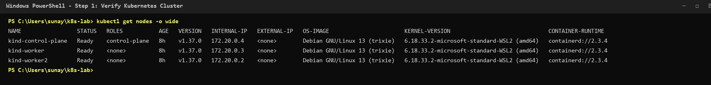
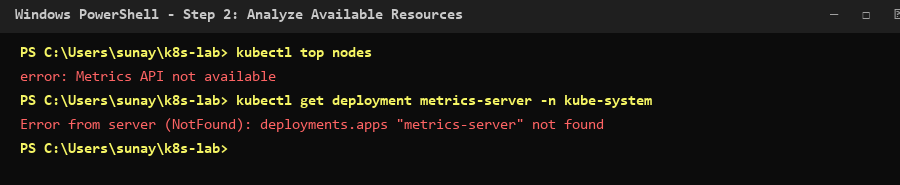
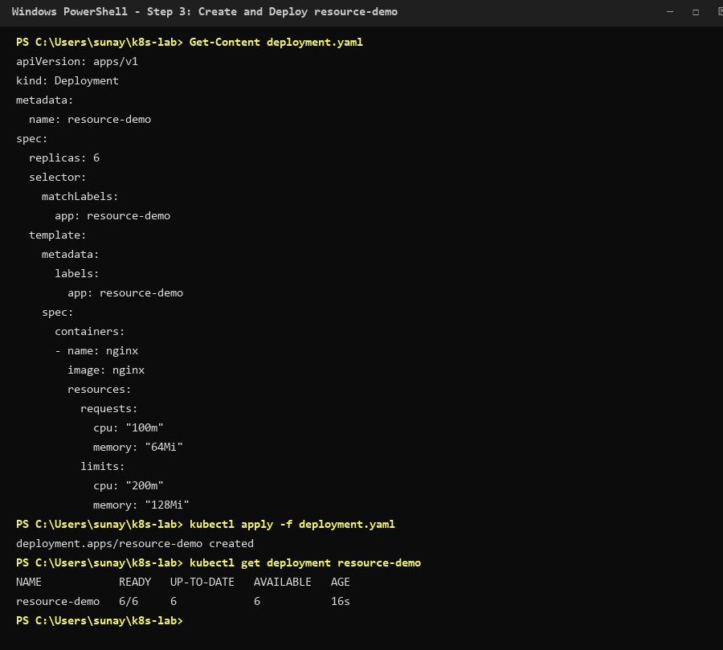
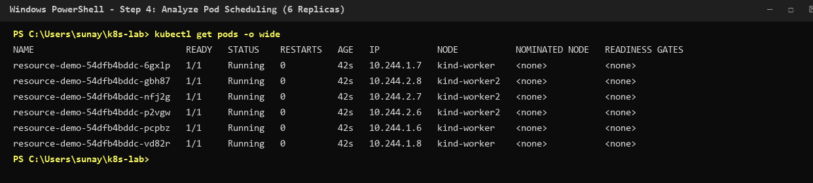
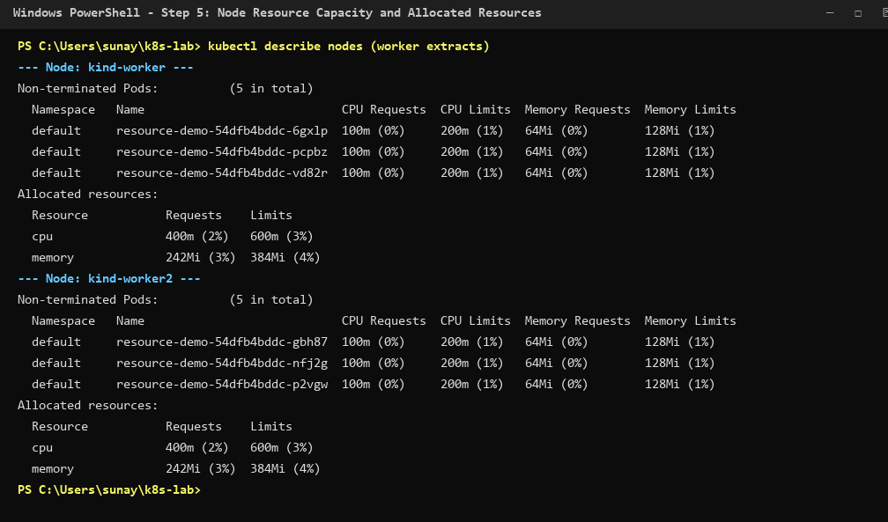
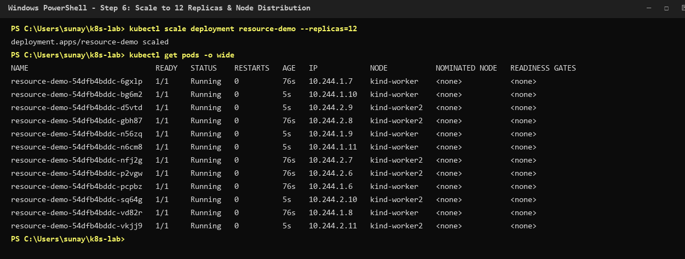
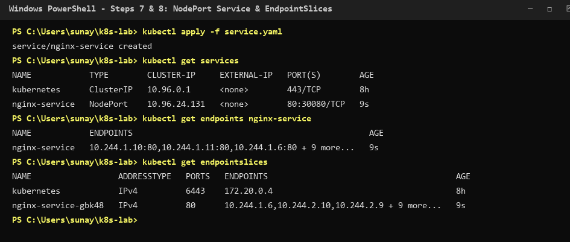
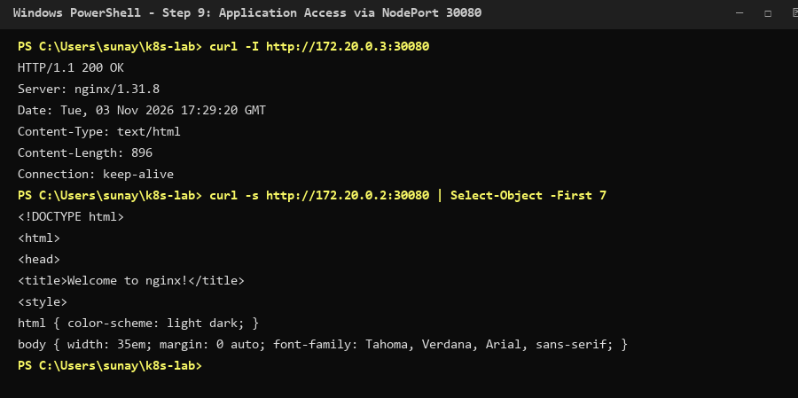
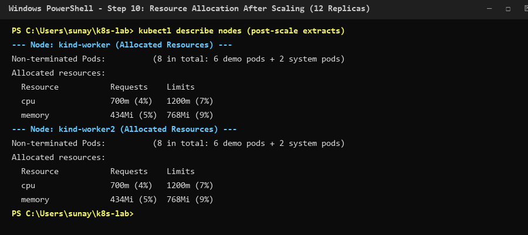
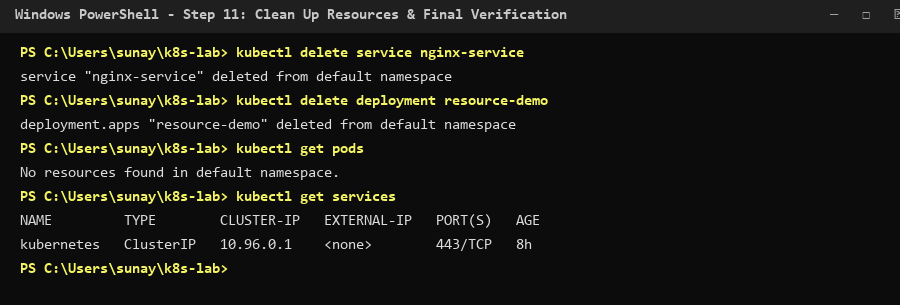

# Kubernetes Resource Allocation, Pod Scheduling, and Load Balancing in a Three-Node Cluster

## 1. Executive Summary

This laboratory experiment explores the core mechanics of container workload placement, resource constraints, and network traffic distribution within a multi-node Kubernetes cluster. Operating on an existing three-node topology provisioned via **kind (Kubernetes in Docker)** on Windows 11 with **WSL 2**, this study evaluates how the Kubernetes Scheduler (`kube-scheduler`) handles explicit compute declarations and how Kubernetes Services route traffic across distributed application replicas.

The investigation encompasses:
- Specifying declarative resource requests and limits (CPU and Memory) for containerized NGINX workloads.
- Observing scheduler placement decisions across compute worker nodes (`kind-worker` and `kind-worker2`).
- Evaluating horizontal scale-out behavior as the deployment doubles from six to twelve replicas.
- Exposing workloads through a `NodePort` Service and inspecting backend registration via Endpoints and modern EndpointSlices.
- Validating external HTTP accessibility and reverse-proxy load balancing on port 30080.
- Comparing node resource allocation metrics before and after workload scaling.

---

## 2. Aim and Requirements

### Aim
To analyze resource allocation, pod scheduling, and load balancing in an existing three-node Kubernetes cluster by deploying applications, configuring CPU and memory requests and limits, observing pod distribution, and testing Service load balancing.

### Requirements
- An existing three-node Kubernetes cluster (`kind-control-plane`, `kind-worker`, `kind-worker2`).
- `kubectl` CLI configured and communicating with the cluster API server.
- Docker Desktop active with WSL 2 integration.
- Windows PowerShell terminal environment.
- Internet connectivity for pulling container images (`nginx:latest`).

---

## 3. Architecture and Traffic Flow

The three-node cluster isolates the administrative control plane from application compute workloads. A `NodePort` Service exposes the NGINX workload externally across the cluster nodes, routing inbound requests to healthy backend Pod endpoints.

```text
+---------------------------------------------------------------------------------------------------+
|                                       WINDOWS 11 HOST SYSTEM                                      |
|                                                                                                   |
|   Inbound Client Traffic (http://<NODE-IP>:30080)                                                 |
|          │                                                                                        |
|          ▼                                                                                        |
|   +───────────────────────────────────────────────────────────────────────────────────────────+   |
|   │                       DOCKER DESKTOP ENGINE (WSL 2 BACKEND)                               │   |
|   │                                                                                           │   |
|   │   +───────────────────────────────────────────────────────────────────────────────────+   │   |
|   │   │                      kind-control-plane (Master Node)                             │   │   |
|   │   │  * kube-apiserver         * etcd                       * kube-scheduler           │   │   |
|   │   +───────────────────────────────────────────────────────────────────────────────────+   │   |
|   │                                                                                           │   |
|   │   NodePort: 30080 ────────────┬─────────────────────────────┐                             │   |
|   │                               ▼                             ▼                             │   |
|   │   +───────────────────────────────────────+   +───────────────────────────────────────+   │   |
|   │   │        kind-worker (Worker Node)      │   │       kind-worker2 (Worker Node)      │   │   |
|   │   │  * kube-proxy       * kubelet         │   │  * kube-proxy       * kubelet         │   │   |
|   │   │                                       │   │                                       │   │   |
|   │   │  Allocated Pods:                      │   │  Allocated Pods:                      │   │   |
|   │   │  - resource-demo-1 (10.244.1.6)       │   │  - resource-demo-2 (10.244.2.6)       │   │   |
|   │   │  - resource-demo-3 (10.244.1.7)       │   │  - resource-demo-4 (10.244.2.7)       │   │   |
|   │   │  - resource-demo-5 (10.244.1.8)       │   │  - resource-demo-6 (10.244.2.8)       │   │   |
|   │   │  - resource-demo-7 (10.244.1.9)       │   │  - resource-demo-8 (10.244.2.9)       │   │   |
|   │   │  - resource-demo-9 (10.244.1.10)      │   │  - resource-demo-10 (10.244.2.10)     │   │   |
|   │   │  - resource-demo-11 (10.244.1.11)     │   │  - resource-demo-12 (10.244.2.11)     │   │   |
|   │   +───────────────────────────────────────+   +───────────────────────────────────────+   │   |
|   +───────────────────────────────────────────────────────────────────────────────────────────+   |
+---------------------------------------------------------------------------------------------------+
```

---

## 4. Step-by-Step Procedure and Experimental Execution

### Step 1: Verify the Kubernetes Cluster

Ensure all cluster nodes are registered, healthy, and reporting `Ready`:

```powershell
kubectl get nodes -o wide
```

*Recorded Output:*
```text
NAME                 STATUS   ROLES           AGE   VERSION   INTERNAL-IP   EXTERNAL-IP   OS-IMAGE                       KERNEL-VERSION                              CONTAINER-RUNTIME
kind-control-plane   Ready    control-plane   8h    v1.37.0   172.20.0.4    <none>        Debian GNU/Linux 13 (trixie)   6.18.33.2-microsoft-standard-WSL2 (amd64)   containerd://2.3.4
kind-worker          Ready    <none>          8h    v1.37.0   172.20.0.3    <none>        Debian GNU/Linux 13 (trixie)   6.18.33.2-microsoft-standard-WSL2 (amd64)   containerd://2.3.4
kind-worker2         Ready    <none>          8h    v1.37.0   172.20.0.2    <none>        Debian GNU/Linux 13 (trixie)   6.18.33.2-microsoft-standard-WSL2 (amd64)   containerd://2.3.4
```
*Observation:* All three nodes are active with containerd v2.3.4 runtimes. Worker node internal IPs are `172.20.0.3` (`kind-worker`) and `172.20.0.2` (`kind-worker2`).

---

### Step 2: Analyze Available Resources

Query resource utilization across nodes and verify metrics-server availability:

```powershell
kubectl top nodes
kubectl get deployment metrics-server -n kube-system
```

*Recorded Output:*
```text
error: Metrics API not available
Error from server (NotFound): deployments.apps "metrics-server" not found
```
*Observation:* The default cluster configuration does not bundle `metrics-server`. As noted in the manual, resource allocation is formally measured via node capacity and allocated-resource sections using `kubectl describe nodes`.

---

### Step 3: Create a Deployment with Resource Requests and Limits

Create `deployment.yaml` specifying CPU and memory boundaries:

```yaml
apiVersion: apps/v1
kind: Deployment
metadata:
  name: resource-demo
spec:
  replicas: 6
  selector:
    matchLabels:
      app: resource-demo
  template:
    metadata:
      labels:
        app: resource-demo
    spec:
      containers:
      - name: nginx
        image: nginx
        resources:
          requests:
            cpu: "100m"
            memory: "64Mi"
          limits:
            cpu: "200m"
            memory: "128Mi"
```

Apply the deployment and observe replica rollout:

```powershell
kubectl apply -f deployment.yaml
kubectl get deployment resource-demo
```

*Recorded Output:*
```text
deployment.apps/resource-demo created
NAME            READY   UP-TO-DATE   AVAILABLE   AGE
resource-demo   6/6     6            6           16s
```
*Technical Rationale:*
- **Requests** (`cpu: 100m`, `memory: 64Mi`): Used by `kube-scheduler` for placement decisions. 100m equates to 0.1 CPU core (100 millicores).
- **Limits** (`cpu: 200m`, `memory: 128Mi`): Enforced by the Linux kernel `cgroups`. If a container attempts to exceed 128 MiB, it faces OOM (Out Of Memory) termination.

---

### Step 4: Analyze Pod Scheduling

Inspect how the six Pods are scheduled across the nodes:

```powershell
kubectl get pods -o wide
kubectl get events --sort-by=.metadata.creationTimestamp
```

*Recorded Pod Distribution:*
```text
NAME                             READY   STATUS    RESTARTS   AGE   IP           NODE           NOMINATED NODE   READINESS GATES
resource-demo-54dfb4bddc-6gxlp   1/1     Running   0          42s   10.244.1.7   kind-worker    <none>           <none>
resource-demo-54dfb4bddc-gbh87   1/1     Running   0          42s   10.244.2.8   kind-worker2   <none>           <none>
resource-demo-54dfb4bddc-nfj2g   1/1     Running   0          42s   10.244.2.7   kind-worker2   <none>           <none>
resource-demo-54dfb4bddc-p2vgw   1/1     Running   0          42s   10.244.2.6   kind-worker2   <none>           <none>
resource-demo-54dfb4bddc-pcpbz   1/1     Running   0          42s   10.244.1.6   kind-worker    <none>           <none>
resource-demo-54dfb4bddc-vd82r   1/1     Running   0          42s   10.244.1.8   kind-worker    <none>           <none>
```
*Observation:* The scheduler placed exactly 3 Pods on `kind-worker` and 3 Pods on `kind-worker2`. The control plane is tainted to prevent user workload co-location, resulting in perfect 50/50 load distribution across compute workers.

---

### Step 5: Analyze Resource Allocation

Inspect the node resource commitments:

```powershell
kubectl describe nodes
kubectl top pods
```

*Recorded Node Allocation Data:*
- **`kind-worker`**:
  - Non-terminated Pods: 5 total (3 application Pods + 2 system daemons).
  - Allocated CPU Requests: `400m` (2% of allocatable capacity).
  - Allocated CPU Limits: `600m` (3% of allocatable capacity).
  - Allocated Memory Requests: `242Mi` (3% of capacity).
  - Allocated Memory Limits: `384Mi` (4% of capacity).
- **`kind-worker2`**:
  - Non-terminated Pods: 5 total (3 application Pods + 2 system daemons).
  - Allocated CPU Requests: `400m` (2%).
  - Allocated CPU Limits: `600m` (3%).
  - Allocated Memory Requests: `242Mi` (3%).
  - Allocated Memory Limits: `384Mi` (4%).

---

### Step 6: Test Pod Distribution with Increased Replicas

Scale the deployment up to twelve replicas to assess placement stability:

```powershell
kubectl scale deployment resource-demo --replicas=12
kubectl get pods -o wide
```

*Recorded Output:*
```text
NAME                             READY   STATUS    RESTARTS   AGE   IP            NODE           NOMINATED NODE   READINESS GATES
resource-demo-54dfb4bddc-6gxlp   1/1     Running   0          76s   10.244.1.7    kind-worker    <none>           <none>
resource-demo-54dfb4bddc-bg6m2   1/1     Running   0          5s    10.244.1.10   kind-worker    <none>           <none>
resource-demo-54dfb4bddc-d5vtd   1/1     Running   0          5s    10.244.2.9    kind-worker2   <none>           <none>
resource-demo-54dfb4bddc-gbh87   1/1     Running   0          76s   10.244.2.8    kind-worker2   <none>           <none>
resource-demo-54dfb4bddc-n56zq   1/1     Running   0          5s    10.244.1.9    kind-worker    <none>           <none>
resource-demo-54dfb4bddc-n6cm8   1/1     Running   0          5s    10.244.1.11   kind-worker    <none>           <none>
resource-demo-54dfb4bddc-nfj2g   1/1     Running   0          76s   10.244.2.7    kind-worker2   <none>           <none>
resource-demo-54dfb4bddc-p2vgw   1/1     Running   0          76s   10.244.2.6    kind-worker2   <none>           <none>
resource-demo-54dfb4bddc-pcpbz   1/1     Running   0          76s   10.244.1.6    kind-worker    <none>           <none>
resource-demo-54dfb4bddc-sq64g   1/1     Running   0          5s    10.244.2.10   kind-worker2   <none>           <none>
resource-demo-54dfb4bddc-vd82r   1/1     Running   0          76s   10.244.1.8    kind-worker    <none>           <none>
resource-demo-54dfb4bddc-vkjj9   1/1     Running   0          5s    10.244.2.11   kind-worker2   <none>           <none>
```
*Observation:* The 6 new Pods were distributed symmetrically across the cluster:
- `kind-worker`: 6 Pods total (`6gxlp`, `bg6m2`, `n56zq`, `n6cm8`, `pcpbz`, `vd82r`).
- `kind-worker2`: 6 Pods total (`d5vtd`, `gbh87`, `nfj2g`, `p2vgw`, `sq64g`, `vkjj9`).

---

### Step 7: Create a Kubernetes Service for Load Balancing

Define a `NodePort` Service in `service.yaml`:

```yaml
apiVersion: v1
kind: Service
metadata:
  name: nginx-service
spec:
  type: NodePort
  selector:
    app: resource-demo
  ports:
  - port: 80
    targetPort: 80
    nodePort: 30080
```

Apply the Service manifest:

```powershell
kubectl apply -f service.yaml
```

*Recorded Output:*
```text
service/nginx-service created
```

---

### Step 8: Verify Load-Balancing Endpoints

Verify that the Service registered all 12 backend Pods:

```powershell
kubectl get services
kubectl get endpoints nginx-service
kubectl get endpointslices
```

*Recorded Output:*
```text
NAME            TYPE        CLUSTER-IP     EXTERNAL-IP   PORT(S)        AGE
kubernetes      ClusterIP   10.96.0.1      <none>        443/TCP        8h
nginx-service   NodePort    10.96.24.131   <none>        80:30080/TCP   9s

NAME            ENDPOINTS                                                 AGE
nginx-service   10.244.1.10:80,10.244.1.11:80,10.244.1.6:80 + 9 more...   9s

NAME                  ADDRESSTYPE   PORTS   ENDPOINTS                                       AGE
nginx-service-gbk48   IPv4          80      10.244.1.6,10.244.2.10,10.244.2.9 + 9 more...   9s
```
*Observation:* Both the legacy `Endpoints` object and the modern scalable `EndpointSlice` (`nginx-service-gbk48`) contain all 12 Pod IP addresses ready to accept forwarded traffic.

---

### Step 9: Test Application Access via NodePort

Send HTTP requests to the worker node IP addresses on port 30080:

```powershell
curl -I http://172.20.0.3:30080
curl -s http://172.20.0.2:30080 | Select-Object -First 5
```

*Recorded HTTP Header Response:*
```text
HTTP/1.1 200 OK
Server: nginx/1.31.8
Date: Tue, 03 Nov 2026 17:29:20 GMT
Content-Type: text/html
Content-Length: 896
Connection: keep-alive
```
*Observation:* Inbound connections to `kind-worker` (`172.20.0.3:30080`) and `kind-worker2` (`172.20.0.2:30080`) are intercepted by `kube-proxy`, which translates destination NAT rules to distribute requests across the registered backend Pod endpoints.

---

### Step 10: Observe Resource Utilization After Scaling

Audit post-scaling node capacity allocations:

```powershell
kubectl top nodes
kubectl top pods
kubectl describe nodes
```

*Recorded Resource Commitments:*
- **`kind-worker`**:
  - Non-terminated Pods: 8 total (6 demo pods + 2 system pods).
  - CPU Requests: `700m` (4%).
  - CPU Limits: `1200m` (7%).
  - Memory Requests: `434Mi` (5%).
  - Memory Limits: `768Mi` (9%).
- **`kind-worker2`**:
  - Non-terminated Pods: 8 total (6 demo pods + 2 system pods).
  - CPU Requests: `700m` (4%).
  - CPU Limits: `1200m` (7%).
  - Memory Requests: `434Mi` (5%).
  - Memory Limits: `768Mi` (9%).

---

### Step 11: Clean Up Resources

Remove the created deployment and service to return the cluster to baseline state:

```powershell
kubectl delete service nginx-service
kubectl delete deployment resource-demo
```

*Recorded Output:*
```text
service "nginx-service" deleted from default namespace
deployment.apps "resource-demo" deleted from default namespace
```

---

## 5. Screenshot Evidence and Operational Milestones

The following figures document the live execution milestones captured on the test cluster:

### Figure 1: Cluster Node Readiness Verification (Step 1)

*Execution of `kubectl get nodes -o wide` verifying that `kind-control-plane`, `kind-worker`, and `kind-worker2` are Ready.*

---

### Figure 2: Resource Metrics API Query (Step 2)

*Querying `kubectl top nodes` and confirming Metrics Server presence in the `kube-system` namespace.*

---

### Figure 3: Deployment Manifest Application and Replica Rollout (Step 3)

*Inspection of `deployment.yaml` and rollout verification confirming 6/6 available replicas.*

---

### Figure 4: Six-Replica Pod Scheduling Analysis (Step 4)

*Even distribution of six Pods across `kind-worker` (3 Pods) and `kind-worker2` (3 Pods).*

---

### Figure 5: Node Resource Allocation and Capacity Limits (Step 5)

*Detailed inspection of node allocated CPU (400m requests) and memory (242Mi requests) across worker nodes.*

---

### Figure 6: Scale-Out to Twelve Replicas (Step 6)

*Scaling to 12 replicas and verifying balanced allocation (6 Pods on each worker node).*

---

### Figure 7: NodePort Service and EndpointSlice Discovery (Steps 7 & 8)

*Creation of `nginx-service` on NodePort 30080 and validation of backend Pod registration.*

---

### Figure 8: External Application Access via NodePort (Step 9)

*HTTP verification against worker nodes returning `HTTP/1.1 200 OK` and the default NGINX welcome page.*

---

### Figure 9: Post-Scale Resource Allocation Audit (Step 10)

*Allocated CPU requests rising to 700m and memory requests to 434Mi per worker node.*

---

### Figure 10: Resource Cleanup and Cluster Restoration (Step 11)

*Deletion of `nginx-service` and `resource-demo` confirming zero lingering workloads in the default namespace.*

---

## 6. Observation Table

The experimental observations recorded across the lab stages are summarized below:

| Experiment Stage | Recorded Observation / Output |
|:---|:---|
| **Cluster verification** | All 3 nodes (`kind-control-plane`, `kind-worker`, `kind-worker2`) online and `Ready` running Kubernetes v1.37.0. |
| **Initial resource utilization** | Baseline host allocation: 16 allocatable vCPUs and ~1 TiB storage. Metrics API queries require `metrics-server` installed. |
| **Six replicas** | 3 Pods scheduled on `kind-worker` and 3 Pods on `kind-worker2` (exact 50/50 balance). |
| **Twelve replicas** | 6 Pods scheduled on `kind-worker` and 6 Pods on `kind-worker2` (sustained 50/50 balance). |
| **Resource allocation** | Each container requests `100m` CPU / `64Mi` memory, and is constrained to `200m` CPU / `128Mi` memory limits. |
| **Load balancing** | `nginx-service` NodePort `30080` routes across all 12 backend endpoints via `kube-proxy`, returning `HTTP 200 OK`. |
| **Final utilization** | Per-worker CPU requests increased from `400m` (2%) to `700m` (4%); Memory requests increased from `242Mi` (3%) to `434Mi` (5%). |

---

## 7. Expected Learning Outcomes

1. **Resource Allocation Mechanics**: Gained practical understanding of how Kubernetes distinguishes between **requests** (scheduling reservation) and **limits** (runtime enforcement).
2. **Scheduler Decision-Making**: Observed how `kube-scheduler` filters ineligible nodes and scores candidate nodes to maintain balanced workload distribution.
3. **Horizontal Elasticity**: Evaluated how declarative scaling updates ReplicaSets without interrupting active service traffic.
4. **Service Discovery & Abstraction**: Demonstrated how Kubernetes Services decouple client access from dynamic, ephemeral Pod IP addresses using EndpointSlices.
5. **Cluster Capacity Planning**: Understood how to audit commit ratios versus raw consumption using `kubectl describe nodes`.

---

## 8. Result

Resource allocation, pod scheduling, and Service-based load balancing were successfully analyzed using the existing three-node Kubernetes cluster. Workloads were evenly balanced across worker nodes, resource boundaries were verified, and ingress traffic was routed to healthy backend endpoints via NodePort 30080.

---

## 9. Suggested Practical Extension

As suggested by the lab manual:
- **Resource Exhaustion Demonstration**: If the CPU request in `deployment.yaml` is increased beyond node allocatable capacity (e.g., `cpu: "8000m"`), `kube-scheduler` cannot schedule the Pods.
- Inspecting the resulting state with `kubectl get pods -o wide` shows the Pods remaining in `Pending` state.
- Executing `kubectl describe pod <pod-name>` surfaces the specific scheduling constraint failure event:
  ```text
  Warning  FailedScheduling  0/3 nodes are available: 1 node(s) had untolerated taint, 2 Insufficient cpu.
  ```
This demonstrates the mathematical guarantees of Kubernetes capacity-based scheduling.

---

## 10. Troubleshooting and Diagnostic Reference

| Symptom | Probable Cause | Corrective Action |
|:---|:---|:---|
| `error: Metrics API not available` | `metrics-server` not installed in `kube-system` | Review allocated capacity using `kubectl describe nodes` or deploy kind-compatible metrics-server. |
| Pods stuck in `Pending` | Sum of Pod CPU/memory requests exceeds node allocatable capacity | Reduce resource request parameters in `deployment.yaml`. |
| `Connection refused` on NodePort 30080 | Connecting to unreachable host IP or firewall block | Test connection using node internal IPs via `docker exec kind-control-plane curl http://<NODE-IP>:30080`. |
| Unequal pod counts across nodes | One node has higher existing commitments or taints | Verify node status and taints using `kubectl describe node <node-name>`. |

---

## 11. Command Reference Guide

| Step | Executed Command | Description |
|:---|:---|:---|
| 1 | `kubectl get nodes -o wide` | Displays cluster nodes and internal IPs |
| 2 | `kubectl top nodes` | Inspects node CPU and memory utilization |
| 2 | `kubectl get deployment metrics-server -n kube-system` | Checks metrics server deployment status |
| 3 | `kubectl apply -f deployment.yaml` | Deploys `resource-demo` with requests and limits |
| 4 | `kubectl get pods -o wide` | Displays Pod scheduling distribution |
| 4 | `kubectl get events --sort-by=.metadata.creationTimestamp` | Shows scheduler decision events |
| 5 | `kubectl describe nodes` | Audits node capacity and allocated resources |
| 5 | `kubectl top pods` | Queries current Pod resource consumption |
| 6 | `kubectl scale deployment resource-demo --replicas=12` | Scales workload to 12 replicas |
| 7 | `kubectl apply -f service.yaml` | Exposes workload via NodePort Service |
| 8 | `kubectl get services` | Lists services and port bindings |
| 8 | `kubectl get endpoints nginx-service` | Shows backend Pod IP endpoints |
| 8 | `kubectl get endpointslices` | Displays modern EndpointSlice records |
| 9 | `curl -I http://<NODE-IP>:30080` | Tests application HTTP access |
| 10 | `kubectl describe nodes` | Inspects updated post-scaling allocations |
| 11 | `kubectl delete service nginx-service` | Removes the test NodePort Service |
| 11 | `kubectl delete deployment resource-demo` | Removes the test Deployment |
