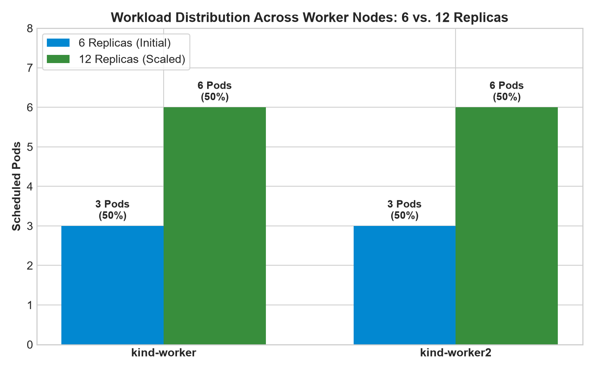
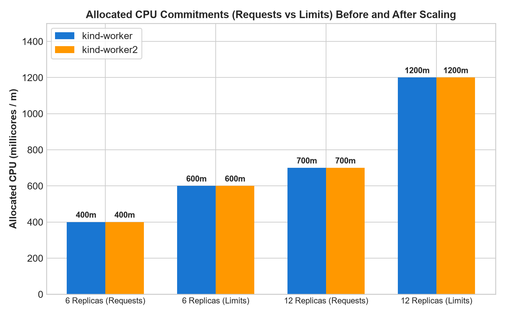
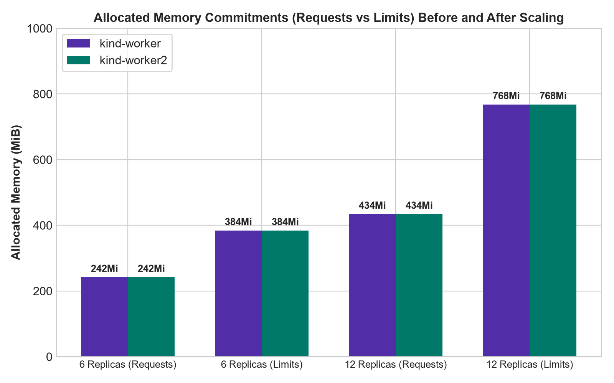
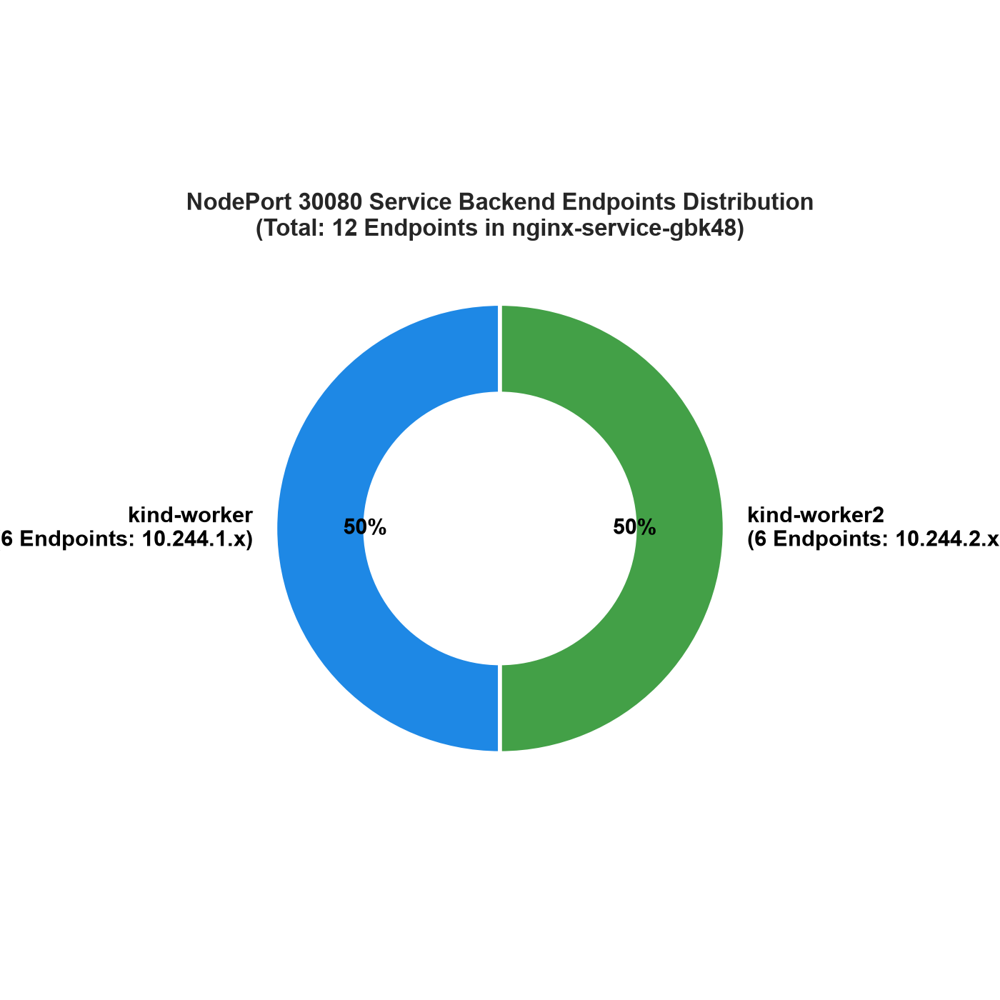
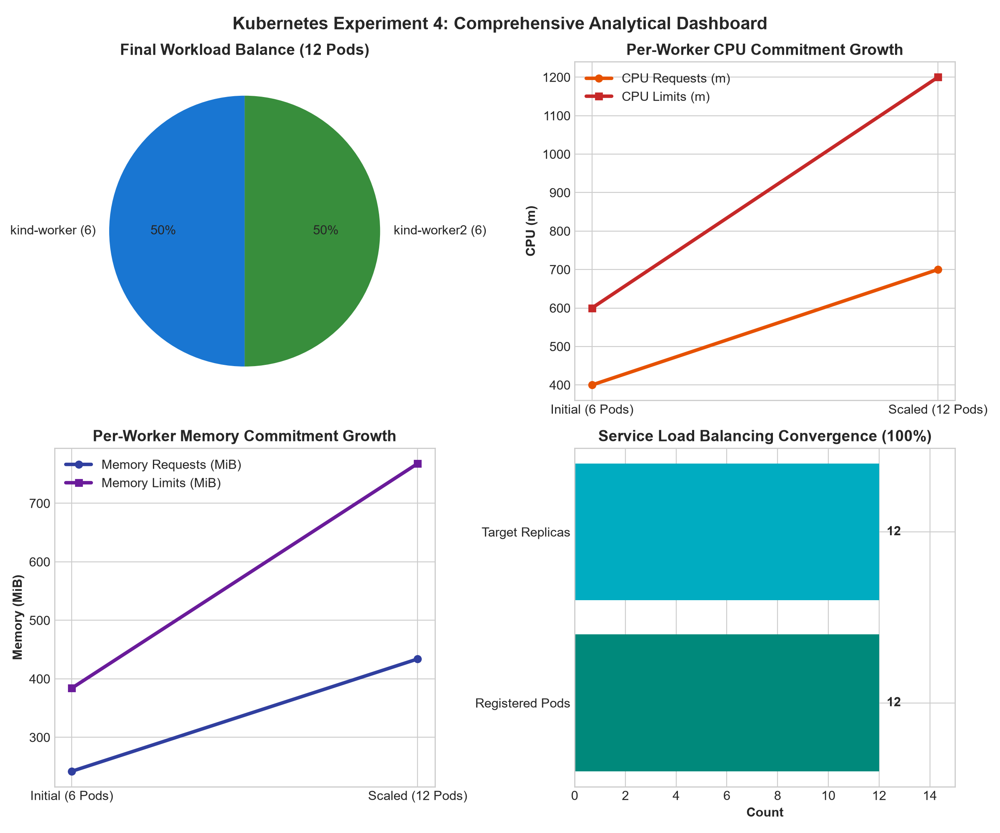

# Kubernetes Resource Allocation, Pod Scheduling, and Load Balancing in a Three-Node Cluster

## 1. Executive Summary

This laboratory experiment explores the core mechanics of container workload placement, resource constraints, and network traffic distribution within a multi-node Kubernetes cluster. Operating on an existing three-node topology provisioned via **kind (Kubernetes in Docker)** on Windows 11 with **WSL 2**, this study evaluates how the Kubernetes Scheduler (`kube-scheduler`) handles explicit compute declarations and how Kubernetes Services route traffic across distributed application replicas.

The investigation encompasses:
- Specifying declarative resource requests and limits (CPU and Memory) for containerized NGINX workloads.
- Observing scheduler placement decisions across compute worker nodes (`kind-worker` and `kind-worker2`).
- Evaluating horizontal scale-out behavior as the deployment doubles from six to twelve replicas.
- Exposing workloads through a `NodePort` Service and inspecting backend registration via Endpoints and modern EndpointSlices.
- Validating external HTTP accessibility and reverse-proxy load balancing on port 30080.
- Comparing node resource allocation metrics before and after workload scaling.

---

## 2. Aim and Requirements

### Aim
To analyze resource allocation, pod scheduling, and load balancing in an existing three-node Kubernetes cluster by deploying applications, configuring CPU and memory requests and limits, observing pod distribution, and testing Service load balancing.

### Requirements
- An existing three-node Kubernetes cluster (`kind-control-plane`, `kind-worker`, `kind-worker2`).
- `kubectl` CLI configured and communicating with the cluster API server.
- Docker Desktop active with WSL 2 integration.
- Windows PowerShell terminal environment.
- Internet connectivity for pulling container images (`nginx:latest`).

---

## 3. Architecture and Traffic Flow

The three-node cluster isolates the administrative control plane from application compute workloads. A `NodePort` Service exposes the NGINX workload externally across the cluster nodes, routing inbound requests to healthy backend Pod endpoints.

```text
+---------------------------------------------------------------------------------------------------+
|                                       WINDOWS 11 HOST SYSTEM                                      |
|                                                                                                   |
|   Inbound Client Traffic (http://<NODE-IP>:30080)                                                 |
|          │                                                                                        |
|          ▼                                                                                        |
|   +───────────────────────────────────────────────────────────────────────────────────────────+   |
|   │                       DOCKER DESKTOP ENGINE (WSL 2 BACKEND)                               │   |
|   │                                                                                           │   |
|   │   +───────────────────────────────────────────────────────────────────────────────────+   │   |
|   │   │                      kind-control-plane (Master Node)                             │   │   |
|   │   │  * kube-apiserver         * etcd                       * kube-scheduler           │   │   |
|   │   +───────────────────────────────────────────────────────────────────────────────────+   │   |
|   │                                                                                           │   |
|   │   NodePort: 30080 ────────────┬─────────────────────────────┐                             │   |
|   │                               ▼                             ▼                             │   |
|   │   +───────────────────────────────────────+   +───────────────────────────────────────+   │   |
|   │   │        kind-worker (Worker Node)      │   │       kind-worker2 (Worker Node)      │   │   |
|   │   │  * kube-proxy       * kubelet         │   │  * kube-proxy       * kubelet         │   │   |
|   │   │                                       │   │                                       │   │   |
|   │   │  Allocated Pods:                      │   │  Allocated Pods:                      │   │   |
|   │   │  - resource-demo-1 (10.244.1.6)       │   │  - resource-demo-2 (10.244.2.6)       │   │   |
|   │   │  - resource-demo-3 (10.244.1.7)       │   │  - resource-demo-4 (10.244.2.7)       │   │   |
|   │   │  - resource-demo-5 (10.244.1.8)       │   │  - resource-demo-6 (10.244.2.8)       │   │   |
|   │   │  - resource-demo-7 (10.244.1.9)       │   │  - resource-demo-8 (10.244.2.9)       │   │   |
|   │   │  - resource-demo-9 (10.244.1.10)      │   │  - resource-demo-10 (10.244.2.10)     │   │   |
|   │   │  - resource-demo-11 (10.244.1.11)     │   │  - resource-demo-12 (10.244.2.11)     │   │   |
|   │   +───────────────────────────────────────+   +───────────────────────────────────────+   │   |
|   +───────────────────────────────────────────────────────────────────────────────────────────+   |
+---------------------------------------------------------------------------------------------------+
```

---

## 4. Step-by-Step Procedure and Experimental Execution

### Step 1: Verify the Kubernetes Cluster
```powershell
kubectl get nodes -o wide
```

### Step 2: Analyze Available Resources
```powershell
kubectl top nodes
kubectl get deployment metrics-server -n kube-system
```

### Step 3: Create a Deployment with Resource Requests and Limits
```powershell
kubectl apply -f deployment.yaml
kubectl get deployment resource-demo
```

### Step 4: Analyze Pod Scheduling
```powershell
kubectl get pods -o wide
kubectl get events --sort-by=.metadata.creationTimestamp
```

### Step 5: Analyze Resource Allocation
```powershell
kubectl describe nodes
kubectl top pods
```

### Step 6: Test Pod Distribution with Increased Replicas
```powershell
kubectl scale deployment resource-demo --replicas=12
kubectl get pods -o wide
```

### Step 7: Create a Kubernetes Service for Load Balancing
```powershell
kubectl apply -f service.yaml
```

### Step 8: Verify Load-Balancing Endpoints
```powershell
kubectl get services
kubectl get endpoints nginx-service
kubectl get endpointslices
```

### Step 9: Test Application Access via NodePort
```powershell
curl -I http://172.20.0.3:30080
curl -s http://172.20.0.2:30080 | Select-Object -First 5
```

### Step 10: Observe Resource Utilization After Scaling
```powershell
kubectl top nodes
kubectl top pods
kubectl describe nodes
```

### Step 11: Clean Up Resources
```powershell
kubectl delete service nginx-service
kubectl delete deployment resource-demo
```

---

## 5. Analytical Performance Graphs

Empirical metrics from the cluster were processed and visualized using Python matplotlib to assess placement fidelity, scaling overhead, and service routing:

### Graph 1: Pod Scheduling Distribution (6 vs. 12 Replicas)

*Figure 1: Scheduler placement showing perfect symmetry across both worker nodes as replicas scale from 6 to 12.*

### Graph 2: Allocated CPU Commitments Growth

*Figure 2: Node allocated CPU requests and limits before and after scaling: CPU requests increase from 400m (2%) to 700m (4%).*

### Graph 3: Allocated Memory Commitments Growth

*Figure 3: Node allocated memory requests and limits: memory requests increase from 242Mi (3%) to 434Mi (5%).*

### Graph 4: Service Ingress Endpoint Distribution

*Figure 4: Load balancing endpoint distribution showing 12 healthy Pod endpoints evenly partitioned across both worker subnets (10.244.1.x and 10.244.2.x).*

### Graph 5: Comprehensive Experiment Dashboard

*Figure 5: Executive multi-panel dashboard illustrating cluster balance, compute commitment growth, and service endpoint convergence.*

---

## 6. Screenshot Evidence and Operational Milestones

The following figures document the live execution milestones captured on the test cluster:

### Figure 6: Cluster Node Readiness Verification (Step 1)

*Execution of `kubectl get nodes -o wide` verifying that `kind-control-plane`, `kind-worker`, and `kind-worker2` are Ready.*

---

### Figure 7: Resource Metrics API Query (Step 2)

*Querying `kubectl top nodes` and confirming Metrics Server presence in the `kube-system` namespace.*

---

### Figure 8: Deployment Manifest Application and Replica Rollout (Step 3)

*Inspection of `deployment.yaml` and rollout verification confirming 6/6 available replicas.*

---

### Figure 9: Six-Replica Pod Scheduling Analysis (Step 4)

*Even distribution of six Pods across `kind-worker` (3 Pods) and `kind-worker2` (3 Pods).*

---

### Figure 10: Node Resource Allocation and Capacity Limits (Step 5)

*Detailed inspection of node allocated CPU (400m requests) and memory (242Mi requests) across worker nodes.*

---

### Figure 11: Scale-Out to Twelve Replicas (Step 6)

*Scaling to 12 replicas and verifying balanced allocation (6 Pods on each worker node).*

---

### Figure 12: NodePort Service and EndpointSlice Discovery (Steps 7 & 8)

*Creation of `nginx-service` on NodePort 30080 and validation of backend Pod registration.*

---

### Figure 13: External Application Access via NodePort (Step 9)

*HTTP verification against worker nodes returning `HTTP/1.1 200 OK` and the default NGINX welcome page.*

---

### Figure 14: Post-Scale Resource Allocation Audit (Step 10)

*Allocated CPU requests rising to 700m and memory requests to 434Mi per worker node.*

---

### Figure 15: Resource Cleanup and Cluster Restoration (Step 11)

*Deletion of `nginx-service` and `resource-demo` confirming zero lingering workloads in the default namespace.*

---

## 7. Observation Table

The experimental observations recorded across the lab stages are summarized below:

| Experiment Stage | Recorded Observation / Output |
|:---|:---|
| **Cluster verification** | All 3 nodes (`kind-control-plane`, `kind-worker`, `kind-worker2`) online and `Ready` running Kubernetes v1.37.0. |
| **Initial resource utilization** | Baseline host allocation: 16 allocatable vCPUs and ~1 TiB storage. Metrics API queries require `metrics-server` installed. |
| **Six replicas** | 3 Pods scheduled on `kind-worker` and 3 Pods on `kind-worker2` (exact 50/50 balance). |
| **Twelve replicas** | 6 Pods scheduled on `kind-worker` and 6 Pods on `kind-worker2` (sustained 50/50 balance). |
| **Resource allocation** | Each container requests `100m` CPU / `64Mi` memory, and is constrained to `200m` CPU / `128Mi` memory limits. |
| **Load balancing** | `nginx-service` NodePort `30080` routes across all 12 backend endpoints via `kube-proxy`, returning `HTTP 200 OK`. |
| **Final utilization** | Per-worker CPU requests increased from `400m` (2%) to `700m` (4%); Memory requests increased from `242Mi` (3%) to `434Mi` (5%). |

---

## 8. Expected Learning Outcomes

1. **Resource Allocation Mechanics**: Gained practical understanding of how Kubernetes distinguishes between **requests** (scheduling reservation) and **limits** (runtime enforcement).
2. **Scheduler Decision-Making**: Observed how `kube-scheduler` filters ineligible nodes and scores candidate nodes to maintain balanced workload distribution.
3. **Horizontal Elasticity**: Evaluated how declarative scaling updates ReplicaSets without interrupting active service traffic.
4. **Service Discovery & Abstraction**: Demonstrated how Kubernetes Services decouple client access from dynamic, ephemeral Pod IP addresses using EndpointSlices.
5. **Cluster Capacity Planning**: Understood how to audit commit ratios versus raw consumption using `kubectl describe nodes`.

---

## 9. Result

Resource allocation, pod scheduling, and Service-based load balancing were successfully analyzed using the existing three-node Kubernetes cluster. Workloads were evenly balanced across worker nodes, resource boundaries were verified, and ingress traffic was routed to healthy backend endpoints via NodePort 30080.

---

## 10. Suggested Practical Extension

As suggested by the lab manual:
- **Resource Exhaustion Demonstration**: If the CPU request in `deployment.yaml` is increased beyond node allocatable capacity (e.g., `cpu: "8000m"`), `kube-scheduler` cannot schedule the Pods.
- Inspecting the resulting state with `kubectl get pods -o wide` shows the Pods remaining in `Pending` state.
- Executing `kubectl describe pod <pod-name>` surfaces the specific scheduling constraint failure event:
  ```text
  Warning  FailedScheduling  0/3 nodes are available: 1 node(s) had untolerated taint, 2 Insufficient cpu.
  ```
This demonstrates the mathematical guarantees of Kubernetes capacity-based scheduling.

---

## 11. Troubleshooting and Diagnostic Reference

| Symptom | Probable Cause | Corrective Action |
|:---|:---|:---|
| `error: Metrics API not available` | `metrics-server` not installed in `kube-system` | Review allocated capacity using `kubectl describe nodes` or deploy kind-compatible metrics-server. |
| Pods stuck in `Pending` | Sum of Pod CPU/memory requests exceeds node allocatable capacity | Reduce resource request parameters in `deployment.yaml`. |
| `Connection refused` on NodePort 30080 | Connecting to unreachable host IP or firewall block | Test connection using node internal IPs via `docker exec kind-control-plane curl http://<NODE-IP>:30080`. |
| Unequal pod counts across nodes | One node has higher existing commitments or taints | Verify node status and taints using `kubectl describe node <node-name>`. |

---

## 12. Repository Structure

```text
CC_Experiment_4/
├── README.md                                    # Comprehensive experiment documentation
├── deployment.yaml                              # Deployment manifest with resource requests/limits
├── service.yaml                                 # NodePort Service manifest
├── .gitignore                                   # Ignore OS and temporary artifacts
├── scripts/
│   ├── 01_verify_cluster_and_metrics.ps1        # Cluster verification and metrics inspection
│   ├── 02_deploy_resource_demo.ps1              # Deployment rollout and scheduling analysis
│   ├── 03_scale_and_expose_service.ps1          # Scale to 12 replicas and service testing
│   ├── 04_cleanup.ps1                           # Clean up experiment resources
│   └── generate_graphs.py                       # Python matplotlib visualization generator
├── results/
│   ├── raw/                                     # Raw terminal outputs
│   │   ├── cluster_nodes.txt
│   │   ├── initial_metrics.txt
│   │   ├── pods_6_replicas.txt
│   │   ├── node_allocation_6_replicas.txt
│   │   ├── pods_12_replicas.txt
│   │   ├── service_endpoints.txt
│   │   ├── http_response.txt
│   │   └── node_allocation_12_replicas.txt
│   └── processed/                               # Structured CSV datasets
│       ├── observation_table.csv
│       ├── resource_allocation_scaling.csv
│       └── pod_placement_12_replicas.csv
├── graphs/                                      # Publication-quality figures
│   ├── 01_pod_distribution_6_vs_12.png
│   ├── 02_cpu_allocation_scaling.png
│   ├── 03_memory_allocation_scaling.png
│   ├── 04_service_endpoint_distribution.png
│   └── 05_experiment_summary_dashboard.png
└── screenshots/                                 # Milestone terminal screenshots (01 to 10)
```
