# Cluster Monitoring Using Metrics Server and Dashboard

Kubernetes & Microservices Deployment - **Problem 20**
KLE Technological University | Cloud Computing Lab Evaluation - 2

> **Problem statement:** Set up resource monitoring on a Kubernetes cluster using Metrics Server and the
> Kubernetes Dashboard, and observe how application load changes pod and node resource usage.

This repository contains everything needed to reproduce the experiment: the Kubernetes manifests, helper
scripts for Windows (PowerShell) and Linux/macOS (bash), the raw measurements, the plotting code, all
generated graphs, the screenshots taken during the run, and the presentation.

**Team / authors:** _add names and USNs here_
**Experiment date:** 2026-11-16

---

## Table of contents

1. [Summary of the experiment](#1-summary-of-the-experiment)
2. [Architecture](#2-architecture)
3. [Environment and versions](#3-environment-and-versions)
4. [Repository structure](#4-repository-structure)
5. [Prerequisites and installation](#5-prerequisites-and-installation)
6. [Quick start](#6-quick-start)
7. [Step-by-step walkthrough](#7-step-by-step-walkthrough)
8. [The sample application and resource settings](#8-the-sample-application-and-resource-settings)
9. [Results](#9-results)
10. [Analysis](#10-analysis)
11. [Problems encountered and how they were solved](#11-problems-encountered-and-how-they-were-solved)
12. [Limitations and honest notes](#12-limitations-and-honest-notes)
13. [Possible extensions](#13-possible-extensions)
14. [Reproducing the graphs](#14-reproducing-the-graphs)
15. [Troubleshooting](#15-troubleshooting)
16. [Cleanup](#16-cleanup)
17. [Concepts and viva notes](#17-concepts-and-viva-notes)
18. [References and license](#18-references-and-license)

---

## 1. Summary of the experiment

| Item | Detail |
|---|---|
| Goal | Observe how application load changes pod and node CPU and memory usage |
| Cluster | Single-node [minikube](https://minikube.sigs.k8s.io/) cluster running Kubernetes v1.37.0 |
| Monitoring | Metrics Server (v0.9.0) feeding both `kubectl top` and the Kubernetes Dashboard |
| Sample application | `php-apache` (the standard Kubernetes `hpa-example` image), 1 replica |
| Load | A `busybox` pod looping `wget` requests against the application's Service |
| What was measured | Pod and node CPU / memory at idle and under load, from `kubectl top` and the Dashboard |

**What was demonstrated** (from the lab sheet):

- Pod and node CPU and memory usage
- Change in usage under load
- Consistency between `kubectl top` and the Dashboard

**Headline result:** the `php-apache` pod went from **5m CPU / 8Mi** at idle to **501m CPU / 13Mi** under
load (about 100x more CPU). The pod reached its configured **500m CPU limit**, so it plateaued there. The
Dashboard and `kubectl top` reported the same values (501m, ~13Mi). Node utilisation stayed flat at about
6% CPU and 11% memory because the node has far more capacity than one half-core pod can use.

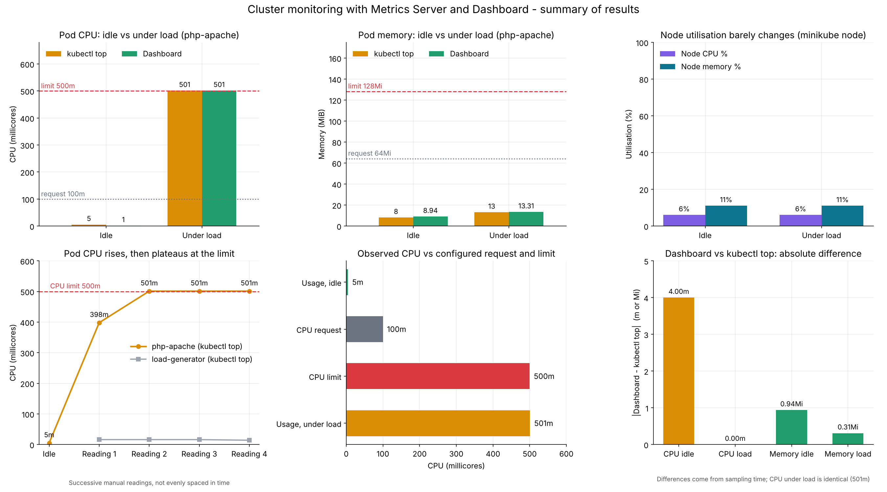

---

## 2. Architecture

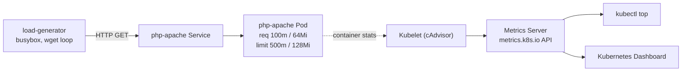

How the pieces fit together:

1. The **load generator** sends HTTP requests in a tight loop to the `php-apache` Service.
2. Each request makes the PHP app do CPU-heavy work, so the pod's resource usage rises.
3. The **kubelet** on the node collects container statistics (via cAdvisor).
4. **Metrics Server** scrapes the kubelets and exposes the aggregated, *current* CPU and memory usage through
   the Kubernetes Metrics API (`metrics.k8s.io`).
5. **`kubectl top`** and the **Dashboard** both read from that API, which is why their numbers agree.

Metrics Server only keeps the latest values (no history) and only tracks CPU and memory.

---

## 3. Environment and versions

| Component | Version / detail | Source |
|---|---|---|
| Host OS | Windows, PowerShell 5.1 | session log |
| Cluster | minikube, 1 node (control-plane), **Kubernetes v1.37.0** | `kubectl get nodes` |
| `kubectl` | v1.37.2 (installed with `winget`) | winget output |
| Metrics Server | image `registry.k8s.io/metrics-server/metrics-server:v0.9.0` (minikube addon) | `minikube addons enable` output |
| Dashboard | Dashboard addon bundled with minikube (`minikube dashboard`) | session log |
| Sample app | `registry.k8s.io/hpa-example` (php-apache) | `manifests/php-apache.yaml` |
| Load generator | `busybox:1.28` | `manifests/load-generator.yaml` |
| minikube version, container driver | _not recorded during the run_ | - |

The node's capacity can be estimated from the percentages (769m = 6% and 870Mi = 11%), which suggests roughly
12 or more CPU cores and about 8 GB of memory visible to the node. This is an estimate, not a recorded value.

---

## 4. Repository structure

```
k8s-cluster-monitoring-lab/
├── README.md
├── LICENSE
├── manifests/
│   ├── php-apache.yaml            # Deployment + Service (the sample app)
│   ├── load-generator.yaml        # Pod that generates load
│   └── optional/hpa.yaml          # OPTIONAL extension: autoscaler (not part of the results)
├── scripts/
│   ├── setup.ps1 / setup.sh                   # start minikube, enable addons, deploy app
│   ├── open-dashboard.ps1 / .sh               # open the Dashboard
│   ├── run-load.ps1 / run-load.sh             # start / stop the load generator
│   ├── collect-metrics.ps1 / .sh              # sample `kubectl top` into a timestamped CSV
│   └── cleanup.ps1 / cleanup.sh               # remove workloads (optionally the cluster)
├── analysis/
│   ├── plot_results.py            # generates every graph from data/*.csv
│   ├── plot_timeseries.py         # plots a CSV recorded by collect-metrics
│   └── requirements.txt
├── data/
│   ├── results.csv                # idle vs load summary (kubectl top + Dashboard)
│   ├── readings_under_load.csv    # successive kubectl top readings
│   └── raw/                       # raw terminal output captured during the run
├── graphs/                        # all generated graphs (PNG)
├── screenshots/                   # screenshots from the run (+ original full-size files)
└── docs/
    ├── concepts-and-viva.md       # concepts explained + likely evaluation questions
    ├── presentation.pptx          # 5-slide presentation
    └── problem-statement.png      # the lab problem slide
```

---

## 5. Prerequisites and installation

You need: a container or VM driver (Docker Desktop is the usual choice), `minikube`, `kubectl`, and (only for
regenerating graphs) Python 3.9+.

**Windows** (run PowerShell as Administrator, then **close and reopen the terminal** so PATH updates apply):

```powershell
winget install Docker.DockerDesktop
winget install Kubernetes.minikube
winget install Kubernetes.kubectl
```

Start Docker Desktop and wait for "Engine running". Verify:

```powershell
minikube version
kubectl version --client
docker version
```

**Linux / macOS:** install Docker, then follow the official guides for
[minikube](https://minikube.sigs.k8s.io/docs/start/) and
[kubectl](https://kubernetes.io/docs/tasks/tools/).

A machine with about 2 CPUs and 4 GB of free RAM is enough. **No GPU is required** - Metrics Server only
reports CPU and memory.

---

## 6. Quick start

**Windows (PowerShell):**

```powershell
.\scripts\setup.ps1            # start minikube, enable Metrics Server + Dashboard, deploy php-apache
.\scripts\open-dashboard.ps1   # leave this window open; the Dashboard opens in your browser

kubectl top nodes              # baseline
kubectl top pods

.\scripts\run-load.ps1         # start load, wait 1-2 minutes
kubectl top nodes              # under load
kubectl top pods

.\scripts\run-load.ps1 -Stop   # stop load
```

**Linux / macOS (bash):**

```bash
./scripts/setup.sh
./scripts/open-dashboard.sh    # keep this terminal open

kubectl top nodes && kubectl top pods
./scripts/run-load.sh
sleep 90 && kubectl top nodes && kubectl top pods
./scripts/run-load.sh stop
```

If PowerShell blocks the scripts, run `Set-ExecutionPolicy -Scope Process Bypass` first.

---

## 7. Step-by-step walkthrough

This is exactly what was done during the experiment.

### Step 1 - Start the cluster

```powershell
minikube start
kubectl get nodes
```

The single node `minikube` reached `Ready` after about two minutes (Kubernetes v1.37.0). Right after start,
some `kube-system` pods (CoreDNS, storage-provisioner) were briefly `Pending`; this is normal and they became
`Running` within a minute or two.

### Step 2 - Enable Metrics Server

```powershell
minikube addons enable metrics-server
kubectl get pods -A
kubectl top nodes
```

The `metrics-server` pod became `Running 1/1`. Once it returns data, `kubectl top nodes` works. Without Metrics
Server, `kubectl top` fails and the Dashboard has no usage figures.

### Step 3 - Open the Dashboard

```powershell
minikube dashboard
```

The usual Helm install of the upstream Dashboard failed (see [section 11](#11-problems-encountered-and-how-they-were-solved)),
so the Dashboard bundled with minikube was used. It opens in the browser through a local proxy and needs no
login token. Keep the terminal open while you use it.

### Step 4 - Deploy the sample application

```powershell
kubectl apply -f manifests/php-apache.yaml
kubectl get pods,svc
```

Result: `pod/php-apache-6978874d4-82t99   1/1   Running` and a ClusterIP Service on port 80.
See [section 8](#8-the-sample-application-and-resource-settings).

### Step 5 - Record the baseline (no load)

```powershell
kubectl top nodes
kubectl top pods
```

Then open the Dashboard at **Workloads -> Pods** (namespace `default`) and capture the same pod's CPU and memory.

### Step 6 - Generate load

```powershell
kubectl run load-generator --image=busybox:1.28 --restart=Never -it --rm -- /bin/sh -c "while true; do wget -q -O- http://php-apache; done"
```

(`manifests/load-generator.yaml` is the declarative equivalent.) The terminal prints `OK!` repeatedly - that is
the application's reply to each request. The actual work happens inside the `php-apache` pod, where every
request runs a CPU-intensive loop.

### Step 7 - Measure under load

Wait 1 to 2 minutes (Metrics Server refreshes periodically), then:

```powershell
kubectl top nodes
kubectl top pods
```

Capture the Dashboard Pods page again. Repeat the `kubectl top` readings a few times to confirm the value is
stable.

### Step 8 - Stop the load

Press `Ctrl + C` in the load-generator window (the `--rm` flag deletes the pod), or run
`kubectl delete pod load-generator`. Optionally re-run `kubectl top pods` after a minute or two to see CPU fall
back toward idle.

---

## 8. The sample application and resource settings

`php-apache` is the standard Kubernetes example used in the autoscaling tutorial. It is a small PHP page behind
Apache that performs a loop of square-root calculations on every request and returns `OK!`. It was chosen
because it is deliberately CPU-bound, so load produces a large, easy-to-see change in pod CPU.

Resources (see [`manifests/php-apache.yaml`](manifests/php-apache.yaml)):

| | CPU | Memory |
|---|---|---|
| **Request** (reserved by the scheduler) | 100m | 64Mi |
| **Limit** (hard ceiling) | 500m | 128Mi |

- **1000m = 1 CPU core**, so 500m is half a core.
- If the container tries to use more CPU than its limit, it is **throttled**, so its usage plateaus at the limit.
- If it exceeds its **memory** limit, it is **OOM-killed** and restarted. That did not happen here (13Mi against 128Mi).

---

## 9. Results

All raw values are in [`data/`](data/) and were read from the terminal and Dashboard during the run.

### 9.1 Idle vs under load

| Metric | Idle - `kubectl top` | Idle - Dashboard | Load - `kubectl top` | Load - Dashboard |
|---|---|---|---|---|
| Pod CPU (`php-apache`) | 5m | 1.00m | **501m** | **501.00m** |
| Pod memory (`php-apache`) | 8Mi | 8.94Mi | **13Mi** | **13.31Mi** |
| Node CPU (`minikube`) | 769m (6%) | not captured | 784m (6%) | not captured |
| Node memory (`minikube`) | 870Mi (11%) | not captured | 900Mi (11%) | not captured |
| `load-generator` pod | - | - | 14-16m CPU, 1-2Mi | 16.00m CPU, 1.57Mi |

Derived changes: pod CPU **+496m (about 100x)**, pod memory **+5Mi (about +62%)**, node CPU +15m, node memory +30Mi.

### 9.2 Successive readings under load

| Reading | php-apache CPU | php-apache memory | Node CPU | Node memory |
|---|---|---|---|---|
| Idle | 5m | 8Mi | 769m (6%) | 870Mi (11%) |
| 1 | 398m | 12Mi | 719m (5%) | 904Mi (11%) |
| 2 | 501m | 13Mi | 727m (6%) | 915Mi (11%) |
| 3 | 501m | 13Mi | 746m (6%) | 885Mi (11%) |
| 4 | 501m | 13Mi | 784m (6%) | 900Mi (11%) |

The readings were taken by hand one after another and are **not evenly spaced in time**.
Raw output: [`data/raw/kubectl-top-under-load.txt`](data/raw/kubectl-top-under-load.txt).

### 9.3 Graphs

All graphs are in [`graphs/`](graphs/) and are generated by [`analysis/plot_results.py`](analysis/plot_results.py).

| File | What it shows |
|---|---|
| [`00_summary.png`](graphs/00_summary.png) | All graphs on one sheet |
| [`01_pod_cpu_idle_vs_load.png`](graphs/01_pod_cpu_idle_vs_load.png) | Pod CPU idle vs load, `kubectl top` vs Dashboard, with request and limit lines |
| [`02_pod_memory_idle_vs_load.png`](graphs/02_pod_memory_idle_vs_load.png) | Pod memory idle vs load, against request and limit |
| [`03_node_utilisation.png`](graphs/03_node_utilisation.png) | Node CPU % and memory % at idle and under load |
| [`04_pod_cpu_plateau.png`](graphs/04_pod_cpu_plateau.png) | Pod CPU rising then plateauing at the 500m limit across readings |
| [`05_cpu_usage_vs_request_limit.png`](graphs/05_cpu_usage_vs_request_limit.png) | Observed usage compared with configured request and limit |
| [`06_tool_agreement.png`](graphs/06_tool_agreement.png) | Absolute difference between Dashboard and `kubectl top` |

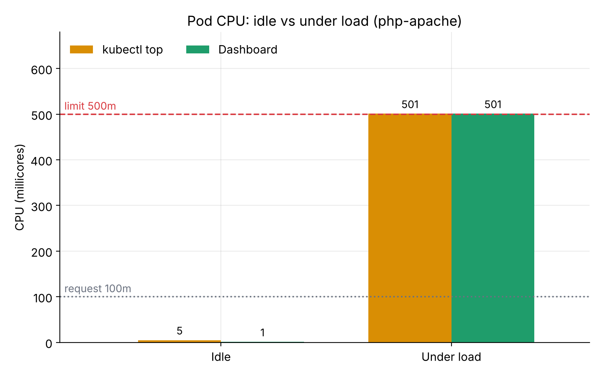

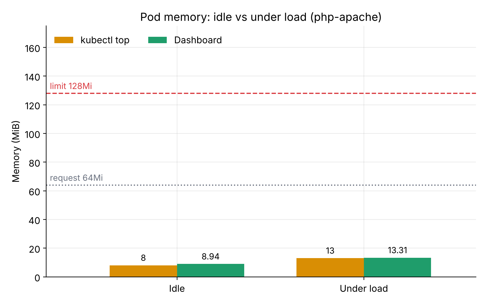

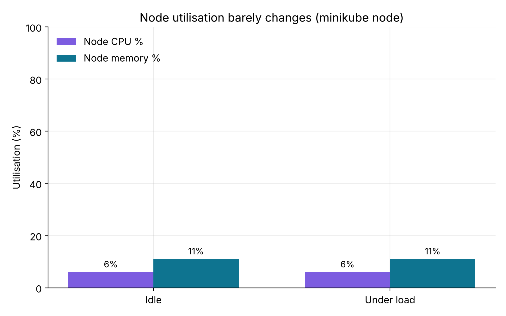

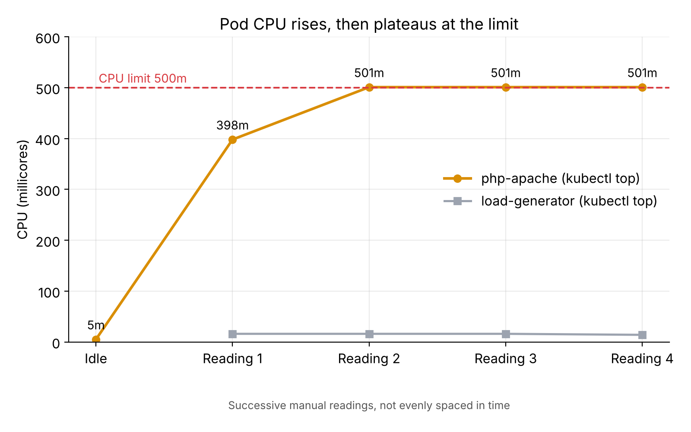

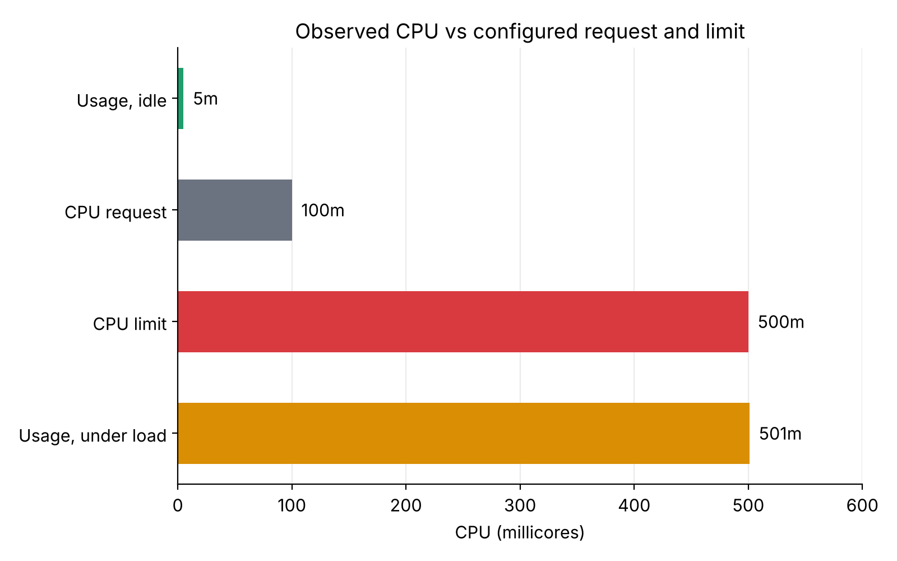

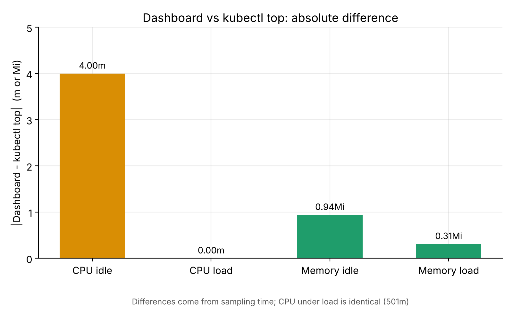

### 9.4 Screenshots

| Stage | `kubectl top` | Dashboard (Workloads -> Pods) |
|---|---|---|
| Idle | 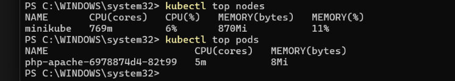 | 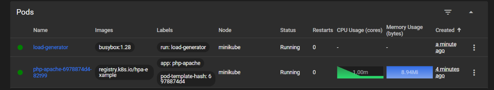 |
| Under load | 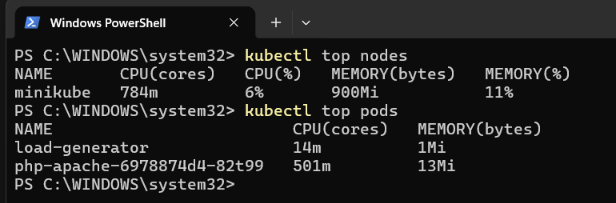 | 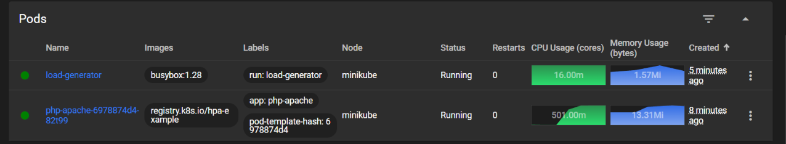 |

Full-size originals are in [`screenshots/original/`](screenshots/original/).
In the idle Dashboard capture, the `load-generator` pod had only just been created and shows no metrics yet, so
`php-apache` is effectively idle.

---

## 10. Analysis

1. **Load changes pod usage.** `php-apache` CPU rose from 5m to 501m (about 100x) and memory from 8Mi to 13Mi.
   This is the direct answer to the problem statement.
2. **CPU plateaued at the limit.** Usage settled at 501m against a 500m limit. Kubernetes throttles the
   container at its limit, so more load could not push usage higher. The first reading (398m) was still ramping
   up; the next three were steady at 501m.
3. **Memory barely moved.** Each request finishes without retaining data, so memory did not accumulate. A
   memory leak would show a steadily climbing line instead.
4. **`kubectl top` and the Dashboard agree.** Under load both show 501m CPU and about 13Mi memory. The only
   visible gap is at idle (5m vs 1.00m), which is sampling-time jitter at near-zero usage; the two tools sample at
   slightly different moments. Both are backed by the same Metrics Server data.
5. **Node-level usage hid the pod-level saturation.** The node stayed at about 6% CPU and 11% memory because a
   half-core pod is small relative to the node. This shows why pod-level metrics are needed for tuning.
6. **The CPU request is undersized.** Observed usage (501m) is about five times the 100m request. Real usage data
   like this is what lets you right-size requests and limits, which is the "why this matters" point of the lab.

---

## 11. Problems encountered and how they were solved

| Problem | Cause | Fix |
|---|---|---|
| `'minikube' is not recognized as an internal or external command` | minikube was not installed yet (and a new shell is needed after install so PATH updates apply) | Installed with `winget`, then reopened the terminal |
| Pods such as CoreDNS and `metrics-server` showed `Pending` right after start | The cluster was only seconds old and the node was still becoming ready | Waited 1-2 minutes; everything reached `Running 1/1` |
| `helm repo add kubernetes-dashboard https://kubernetes.github.io/dashboard/` -> `404 Not Found`, then `Error: repo kubernetes-dashboard not found` | The upstream Kubernetes Dashboard project was archived (Jan 2026) and its Helm chart repo location no longer serves the index | Used the Dashboard bundled with minikube instead: `minikube dashboard` (needs no Helm or token) |

---

## 12. Limitations and honest notes

- **Manual sampling.** The values in `data/` were read by hand from `kubectl top` and the Dashboard, not logged
  automatically, so the readings have no precise timestamps. `scripts/collect-metrics.*` is provided so a rerun can
  record a proper timestamped series.
- **Single run, single node.** One load pattern was used on a one-node cluster. This is enough to demonstrate the
  effect the lab asks about but is not a statistical benchmark.
- **Dashboard node figures not captured.** The Dashboard's Nodes page was not screenshotted, so node values come
  from `kubectl top` only.
- **The load was not scaled.** The load generator is one sequential loop. It was enough to saturate the 500m limit,
  but the experiment does not show behaviour beyond that point.
- **Metrics resolution.** Metrics Server reports current averaged values refreshed roughly every 15-60 seconds,
  so very short spikes are not visible.
- **Dashboard status.** The upstream Kubernetes Dashboard project is archived; minikube still bundles it. Headlamp
  is the commonly suggested successor.

---

## 13. Possible extensions

- **Autoscaling:** `kubectl apply -f manifests/optional/hpa.yaml` creates a Horizontal Pod Autoscaler that uses the
  same Metrics Server data. With a 100m request and a 50% target, sustained load of about 500m would drive it to
  its maximum of 5 replicas. Watch with `kubectl get hpa php-apache -w`.
- **Multi-node cluster:** `minikube start --nodes 3` to compare usage per node and see replicas spread by the
  scheduler (not needed for the lab's goal).
- **Timestamped series:** run `scripts/collect-metrics.*` during a load run, then `python analysis/plot_timeseries.py`.
- **Long-term history and alerts:** add Prometheus and Grafana, since Metrics Server keeps no history.
- **Heavier load:** run several load generators or scale `php-apache` to more replicas.

---

## 14. Reproducing the graphs

```bash
python -m venv .venv
# Windows: .venv\Scripts\activate     Linux/macOS: source .venv/bin/activate
pip install -r analysis/requirements.txt
python analysis/plot_results.py          # regenerates graphs/00-06 from data/*.csv
```

To plot a fresh timestamped run:

```powershell
.\scripts\collect-metrics.ps1 -IntervalSeconds 10 -DurationSeconds 300   # start before the load, keep running
.\scripts\run-load.ps1
python analysis\plot_timeseries.py       # writes graphs/timeseries_*.png
```

---

## 15. Troubleshooting

| Symptom | What to do |
|---|---|
| `kubectl top` says *metrics not available yet* | Wait 30-60 seconds and retry; confirm `kubectl get pods -n kube-system` shows `metrics-server` as `1/1 Running` |
| Metrics Server pod not ready or TLS errors (non-minikube clusters) | Add the `--kubelet-insecure-tls` argument to the metrics-server deployment (lab clusters only) |
| Dashboard shows no CPU / memory values | Confirm `kubectl top pods` works first, wait a minute, refresh the page; make sure the namespace selector is `default` |
| Pod stuck in `ContainerCreating` | The image is still downloading. If it persists, `kubectl describe pod -l app=php-apache` and read the Events section |
| `minikube dashboard` closes or the page stops loading | The command must keep running; restart it |
| PowerShell script blocked | `Set-ExecutionPolicy -Scope Process Bypass` |
| CPU does not rise under load | Check the load generator is running (`kubectl get pods`) and that you waited 1-2 minutes |

---

## 16. Cleanup

```powershell
.\scripts\cleanup.ps1                  # delete the app and load generator, keep the cluster
.\scripts\cleanup.ps1 -DeleteCluster   # also delete the minikube cluster
minikube stop                          # or just pause the cluster
```

---

## 17. Concepts and viva notes

A plain-language explanation of every concept used here (pods, deployments, requests vs limits, millicores,
Metrics Server, throttling vs OOM-kill) plus likely evaluation questions and short answers is in
[`docs/concepts-and-viva.md`](docs/concepts-and-viva.md).

---

## 18. References and license

- Kubernetes Metrics Server: <https://github.com/kubernetes-sigs/metrics-server>
- Resource metrics pipeline: <https://kubernetes.io/docs/tasks/debug/debug-cluster/resource-metrics-pipeline/>
- Horizontal Pod Autoscaler walkthrough (source of the `php-apache` example): <https://kubernetes.io/docs/tasks/run-application/horizontal-pod-autoscale-walkthrough/>
- minikube documentation: <https://minikube.sigs.k8s.io/docs/>
- Managing container resources (requests and limits): <https://kubernetes.io/docs/concepts/configuration/manage-resources-containers/>

Released under the [MIT License](LICENSE).
